# SkyDuel ✈️ — дуель біпланів у браузері

[](https://github.com/DeorixProg/skyduel/actions/workflows/ci.yml)
[](https://github.com/DeorixProg/skyduel/actions/workflows/deploy.yml)

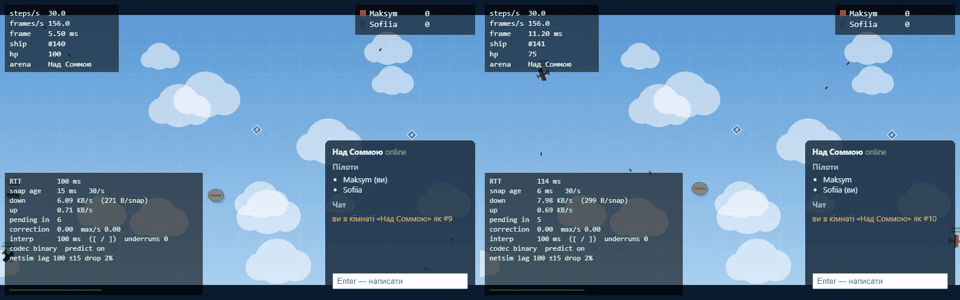

**Гра в реальному часі для кількох гравців.** Біплани Першої світової, аеростати загородження, бонуси і
кілл-фід. Сервер на Node.js рахує світ 30 разів на секунду, а браузер передбачає власний літак і
плавно інтерполює чужі.

- ▶ **Грати:** <https://skyduel.fly.dev> *(адреса з'являється після першого релізу `v*`, див. «Деплой»)*
- 🎬 **Відео (3–5 хв):** *посилання додається після запису*
- 📦 **Образ:** `ghcr.io/deorixprog/skyduel`

Проєкт курсу «Програмування на JavaScript» (викладач — Малькевич Роман Ігорович).
Автор — **Яхимович Максим Сергійович**, група Б-122-23-1-УС.

## Як грати

| Клавіша | Дія |
|---|---|
| **W / ↑** | газ |
| **A D / ← →** | поворот |
| **Space** | постріл |
| **Enter** | чат |
| **[ / ]** | затримка інтерполяції (для netgraph) |

1. Ввести ім'я, вибрати кімнату (або створити свою) і натиснути **Join**.
2. Збивати суперників. Аеростат лопається від трьох куль і з імовірністю 50 % лишає бонус:
   - **S** — щит;
   - **R** — скорострільність;
   - **H** — самонавідні кулі.
3. Таран аеростата чи іншого літака коштує 34 HP. Збитий літак повертається через 2 с.

Гру можна встановити як застосунок (PWA): «Встановити» в меню Chrome або «На початковий екран» на телефоні.

## Запустити локально за три команди

```bash
npm install
npm run build
npm start          # http://localhost:8080
```

Розробка: `npm run dev` (сервер :8080 + Vite :5173). Перевірки:
- `npm run typecheck`
- `npm run lint`
- `npm test`
- `npm run coverage`
- `npm run e2e`

Production-подібно в Docker: `docker compose up --build`.

## Архітектура

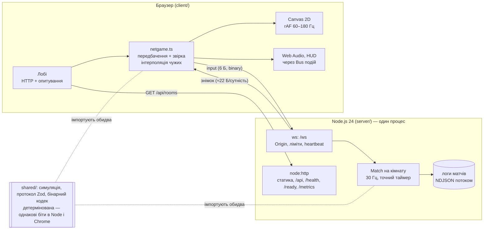

- **Сервер — єдиний авторитет.** Клієнт надсилає лише input, сервер — знімки стану з `ack`.
- **`shared/` — один і той самий TypeScript-код у браузері й у Node.** Без DOM і без модулів Node, з власною тригонометрією
  (`dmath`), бо `Math.sin` у Node 26 і в Chrome 156 відрізняється останніми бітами.
- **Протокол:** керуючі повідомлення — JSON зі схемою Zod, гра — бінарні кадри через `DataView` (little-endian, байт
  версії, кут як Int16).

## Цифри

| Що | Результат | Де детально |
|---|---|---|
| Відгук на клавішу при RTT 100 мс | **32 мс** з передбаченням проти 204 мс без нього | лаба 5 |
| Знімок 4 гравців: JSON → бінарний | 3 727 → **506 Б**, 109.6 → **14.9 КБ/с**, кодування 33.6 → **5.5 мкс** | лаба 5 |
| Поправки звірки, детермінована симуляція | p50 **0.00008** од. (округлення float32) | лаба 5 |
| Сміття клієнта за 30 с бою з 8 ботами | 125 → **55 МБ**; найдовший кадр 55.5 → **9.1 мс**; кадр p99 **6.0 мс** | лаба 7 |
| Тести | **95** (Vitest + 7 властивостей fast-check) + e2e Playwright; покриття `shared/` **95.9 %** рядків | лаба 7 |
| Крок сервера, 256 ботів | p99 35.6 → **18.7 мс** після кешу для ШІ ботів | лаба 7 |
| **Ємність одного процесу** | **≈ 280 гравців в одній кімнаті** (крок p99 30.8 мс при 256, 36.5 при 320) | лаба 7 |
| Флуд 1300 валідних повідомлень/с | закрито кодом 4008 за **105 мс**, крок чужої кімнати p99 **1.2 мс** | лаба 8 |
| Сервер убито посеред матчу | гравець у лобі за **42 мс** з повідомленням; після рестарту грає далі | лаба 8 |

## Обмеження (і чому вони такі)

- **Один процес на всі кімнати.** Матч живе в пам'яті процесу, тож усі гравці кімнати мусять бути в
  одному процесі. Горизонтальне масштабування потребує sticky-маршрутизації за кімнатою (Fly `fly-replay` або
  Redis-реєстр «кімната → машина»). Для курсового навантаження вистачає однієї машини: ≈ 280 гравців.
- **Трафік O(n²).** Кожен клієнт отримує всі сутності, а знімок кодується для кожного окремо (через свій `ack`).
  Саме це, а не фізика, обмежує ємність.
- **Немає компенсації лагу.** Сервер перевіряє влучання в теперішньому стані, а стрілець бачить ціль ~100 мс +
  RTT/2 у минулому. По швидкому літаку інколи треба брати упередження.
- **Чити.** Координати від клієнта не приймаються, input обмежений за формою й частотою. Але знімок містить
  усю арену, тож «wallhack» і aimbot теоретично можливі. Для арени без укриттів це прийнятно.
- **Major GC у браузері.** Короткі (≤ 3 мс) завершення інкрементального маркування раз на ~1.6 с лишилися: це декодування
  знімків і `MessageEvent` самого WebSocket. Див. лабу 7.
- **Немає акаунтів:** ім'я — просто рядок, рахунок живе до кінця матчу.

## Що далі

1. Кодувати тіло знімка один раз і **delta-знімки** (надсилати лише зміни відносно підтвердженого) —
   це головний важіль ємності.
2. **Компенсація лагу** («перемотування» хітбоксів на час, який бачив стрілець).
3. Кілька процесів: Redis-реєстр кімнат + маршрутизація до машини кімнати.
4. Матчмейкінг (кімнати за рівнем і регіоном), акаунти й таблиця рекордів.
5. Сенсорне керування для телефона, щоб PWA була не лише «встановлюваною», а й зручною.

## Історія тегів

| Тег | Що додано |
|---|---|
| `lab-01` | ігровий цикл з фіксованим кроком, біплан, керування, три експерименти |
| `lab-02` | сутності, `World` на `Map`, кулі, аеростати, зіткнення, вибухи, респаун, homing і бонуси через композицію |
| `lab-03` | завантаження ассетів з прогресом, повторами і abort, спрайти, Web Audio, шина подій, лобі |
| `lab-04` | Node-сервер: npm workspaces, HTTP API, кімнати, WebSocket-чат, ліміти, логи матчів потоками |
| `lab-05` | авторитетний сервер 30 Гц, спільна симуляція, передбачення і звірка, інтерполяція, бінарний протокол, netgraph |
| `lab-06` | TypeScript strict у всіх пакетах, Zod на кожній межі, branded id, вичерпні `switch`, CI з typecheck |
| `lab-07` | 91 тест (Vitest + fast-check), Playwright e2e, CI, профілювання і прибирання GC-сміття, боти, навантажувальний тест |
| `lab-08`, `v1.0.0` | production-сервер (pino, /metrics, /ready, Origin, ліміти), хаос-тести, Docker, деплой за тегом, PWA, ця сторінка |

Скрипти вимірювань лаб 1–3 (`tools/measure-lab*.mjs`) очікують `npm run build -w client && npx -w client vite preview --port 4173`.
Усі скрипти з Chrome запускають його без звуку (`--mute-audio`).

---

# Журнал лабораторних

## Лабораторна 1. Цикл подій — це ігровий цикл

### Що зроблено

| Модуль | Призначення |
|---|---|
| `src/loop.js` | `createLoop({ step, simulate, render })` — `requestAnimationFrame` + акумулятор з обмеженням 0.25 с; рахує steps/s, frames/s і час кадру |
| `src/input.js` | `createInput(target)` — замикання над приватними `Set`; `isDown`, `justPressed`, `endStep` |
| `src/sim/ship.js` | біплан як звичайний об'єкт `{ x, y, vx, vy, angle, thrust }`; чиста функція `integrate(ship, input, dt)` |
| `src/sim/arena.js` | арена 1600×900 одиниць, «загортання» країв, `wrapDelta` |
| `src/render/canvas.js` | канвас з урахуванням `devicePixelRatio`, ресайз, камера з letterbox |
| `src/render/draw.js` | фон з хмарами і сіткою, біплан через `translate`/`rotate`, полум'я вихлопу, HUD |
| `src/experiments.js` | перемикачі експериментів через query-рядок і запис тривалості кадрів |

У `sim/` немає жодного звернення до DOM чи canvas: стан і вхід — звичайні дані, `integrate` повертає новий об'єкт.

**`justPressed` скидається після кожного кроку симуляції, а не після кадру.** За фіксованого кроку
кадр може виконати 0, 1 або 3 кроки. Якщо скидати після кадру, натискання або загубиться (кадр без
кроків), або спрацює двічі. Ще одна дрібниця — подія `blur` очищує натиснуті клавіші, щоб після
Alt+Tab газ не «залипав».

**Інтерполяція.** Рендер малює `lerp(previous, current, alpha)`. Тут легко припуститися двох класичних помилок:
1. Кут: між 179° і −179° треба йти через 180°, а не робити оберт через 0° (`lerpAngle`).
2. Край арени: коли корабель перелітає через край, `previous.x = 1598`, а `current.x = 2`. Звичайний
   lerp на один кадр протягнув би його через усю арену. `wrapDelta` бере найкоротшу відстань на торі.
   Біля країв малюються «привиди» корабля, тому перехід виглядає безшовним.

**Налаштування польоту (M2).** Спершу `TURN_RATE = 5` рад/с — корабель смикався, точно
прицілитися було неможливо. Значення 2.5 давало надто широкі розвороти, і бій втрачав динаміку.
Залишив 3.4 (повне коло за 1.85 с). `THRUST = 520`, `DRAG = 0.9`: 85 % максимальної швидкості
(420 од/с) корабель набирає приблизно за 2 с, а після відпускання газу плавно гальмує, як літак, а не
як космічний корабель без тертя. Арену 1600 од. корабель перетинає приблизно за 4 с.

### Як міряли

Збірку (`vite build` + `vite preview`) запускав у Google Chrome через Playwright
(`tools/measure-lab1.mjs`). Тривалості кадрів записує сама сторінка через `performance.now()` у
кожному виклику `render`.

- Машина: AMD Ryzen 5 2600 (6 ядер / 12 потоків), Windows 10.
- **Монітор 180 Гц**, тому «норма» тут — 180 кадрів/с, а не 60.

**Базова лінія (rAF + акумулятор, 10 с):**

| Показник | Значення |
|---|---|
| steps/s | **60.0** |
| frames/s | **179** |
| інтервал кадру p50 / p95 / p99 | 5.60 / 5.70 / 5.80 мс |
| стандартне відхилення | 0.15 мс |
| робота в кадрі (simulate + render) | ≈ 0.2 мс |
| кроків симуляції за 10 с | 601 |


Симуляція виконується рівно 60 разів на секунду, хоча кадрів утричі більше. На двох із трьох кадрів
`simulate` не викликається: рендер лише інтерполює між тими самими двома станами з різним `alpha`.

### Експеримент 1 — блокувальний цикл у кадрі (`?exp=block`)

У `render` кожного 60-го кадру додав `while (performance.now() < t + 100) {}`.

| Показник | Базова лінія | З блокуванням |
|---|---|---|
| frames/s | 179 | **146** |
| інтервал кадру p50 | 5.6 мс | 5.6 мс |
| інтервал кадру p99 / max | 5.8 / 9.9 мс | **100.5 / 101.1 мс** |
| кроків симуляції за 10 с | 601 | 597 |

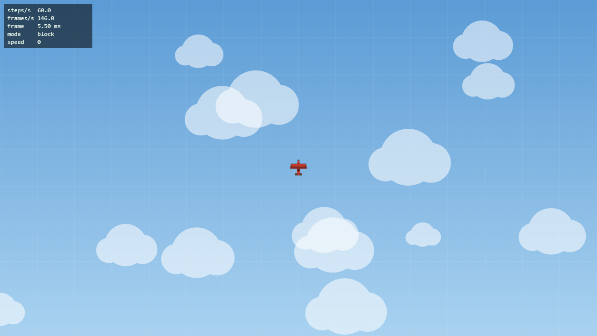

**Що бачить гравець.** На 180 Гц 60-й кадр трапляється тричі на секунду. Отже, тричі на секунду гра
завмирає на 0.1 с. Після кожної паузи корабель «перестрибує» вперед: акумулятор отримує 0.1 с
і виконує 6 кроків поспіль. Клавіші під час паузи не реагують, бо події клавіатури лежать у черзі
задач. Значення HUD теж оновлюються ривками.

У HUD steps/s залишається близьким до 60 (597 кроків за 10 с), бо акумулятор доганяє пропущений
час. Fixed timestep рятує *симуляцію*, але не *плавність*.

**Чому це неможливо обійти з JavaScript у тому самому потоці.** Цикл подій бере наступну задачу
лише тоді, коли стек викликів порожній. Поки `while` виконується, стек не порожній. Тож не
спрацюють `setTimeout`, обробники `keydown`, мікрозадачі, наступний rAF і навіть малювання кадру,
бо рендеринг теж є кроком того самого циклу. Перервати функцію неможливо (run-to-completion),
тому будь-який «обхід» сам був би кодом у черзі, яка чекає. Допомагають лише три речі:
- не блокувати потік;
- розбити роботу на шматки (`scheduler.yield()` / `setTimeout`);
- винести її в інший потік (Web Worker).

### Експеримент 2 — `setInterval(frame, 16)` замість rAF (`?exp=interval`)

| Показник (10 с, вкладка активна) | rAF | `setInterval(…, 16)` |
|---|---|---|
| frames/s | 179 | **62.5** |
| середній інтервал | 5.56 мс | 16.00 мс |
| джитер (σ) | 0.15 мс | 0.32–0.45 мс |
| p99 / max | 5.8 / 9.9 мс | 17.0 / 17.6 мс |
| steps/s | 60 | 60 |

Потім вікно згорталося на 5 с (`tools/measure-lab1-hidden.mjs`):

| За 5 с у згорнутому вікні | rAF | `setInterval` |
|---|---|---|
| викликів `frame` | 5 (по ~1000 мс) | 408 (по 16 мс) |
| кроків симуляції за 6.5 с (5 с фону + 1.5 с) | **167** замість 390 | 392 |

**Висновки:**
1. **`setInterval` не знає про дисплей.** 16 мс — це не період оновлення ні 60 Гц (16.67), ні
   180 Гц (5.56) монітора. Кадр показується на найближчому vsync, тож інтервал між *показаними*
   кадрами чергує 3 і 2 vsync. Тому рух нерівний (judder), хоча самі виклики таймера майже
   рівні: σ 0.4 мс. Крім того, гра на 180 Гц моніторі обмежилася 62 кадрами.
2. **Таймер не синхронізований з рендерингом.** Колбек — звичайна задача. Браузер може
   намалювати кадр до неї або після неї, тому частина обчисленого рендеру ніколи не потрапляє на
   екран. rAF, навпаки, викликається рівно перед paint.
3. **Прихована вкладка.**
   - rAF браузер пригальмував до ~1 кадру/с. Акумулятор обмежений 0.25 с, тому за
     кожну секунду у фоні симуляція просунулася лише на 0.25 с: «гра на паузі», без вибуху з сотень
     кроків після повернення.
   - `setInterval` у цьому запуску продовжив працювати з частотою 62/с: Chrome гальмує таймери до
     1 Гц лише у вкладці зі станом `hidden`, а згорнуте автоматизоване вікно цей стан не отримало.
     Тобто таймер даремно палить CPU на анімацію, яку ніхто не бачить.
   - Для гри це гірше за будь-який варіант rAF. До того ж у по-справжньому прихованій вкладці
     таймер обмежився б до 1 Гц, а через 5 хв — до 1 разу на хвилину.

Після експерименту повернув rAF.

### Експеримент 3 — змінний крок замість фіксованого (`?exp=variable&autopilot=1`)

Автопілот 5 *симульованих* секунд тримає газ і легкий поворот (`turn = 0.25`), потім записує
позицію. CPU сповільнювався в DevTools Protocol через `Emulation.setCPUThrottlingRate`.

| Режим | CPU | Кроків | x | y |
|---|---|---|---|---|
| фіксований 1/60 | 1× | 300 | 280.3179547 | 634.1666986 |
| фіксований 1/60 | 6× | 300 | 280.3179547 | 634.1666986 |
| змінний | 1× | 901 | 280.4961140 | 627.8466555 |
| змінний | 6× | 878 | **282.8486266** | 627.9437712 |

- **Із фіксованим кроком** позиції збігаються до останнього знаку: 300 однакових кроків з однаковим
  входом дають однаковий результат, хоч би яка була частота кадрів.
- **Зі змінним кроком** траєкторія залежить від того, як нарізано час на кадри. Тож прогін 1× відрізняється від прогону 6×
  (Δx = 2.35 од.), і обидва відрізняються від фіксованого (Δy ≈ 6.3 од.). Причина — явний
  метод Ейлера. Опір `v *= 1 − k·dt` і тяга `v += a·dt` мають похибку порядку dt, тож 901 маленький
  крок по 5.5 мс і 878 нерівних кроків (з паузами до 70 мс під 6×) дають різні суми.
- Для мультиплеєра (лаба 5) це фатально: клієнт і сервер мають отримати *ідентичний* стан з
  ідентичних входів. Тому фіксований крок повернуто.

### Відповіді на питання для захисту (коротко)

- **Мікрозадачі vs задачі.** Після кожної задачі черга мікрозадач вичерпується *повністю*, і лише
  тоді браузер може рендерити. Мікрозадача, що ставить нову мікрозадачу, виконується в тому самому
  проході. Через це нескінченний ланцюжок `.then` «морить голодом» рендер. Ланцюжок
  `setTimeout` — ні: кожен колбек є окремою задачею, і між ними є шанс намалювати кадр.
- **Де rAF.** Після задачі та мікрозадач, на кроці рендерингу: rAF-колбеки → style → layout → paint.
- **Замикання захоплює змінні, а не значення.** `for (var i…) setTimeout(() => log(i))` друкує
  3, 3, 3: одна змінна на всю функцію. З `let` друкує 0, 1, 2: нова прив'язка на кожну ітерацію.
- **`type="module"`:**
  - власна область видимості файлу;
  - strict mode;
  - `defer` за замовчуванням;
  - `this === undefined` на верхньому рівні;
  - статичні `import`/`export` з живими прив'язками, модуль виконується один раз;
  - top-level `await`;
  - CORS для завантаження.

---

## Лабораторна 2. Об'єкти, прототипи і `this`: модель сутностей

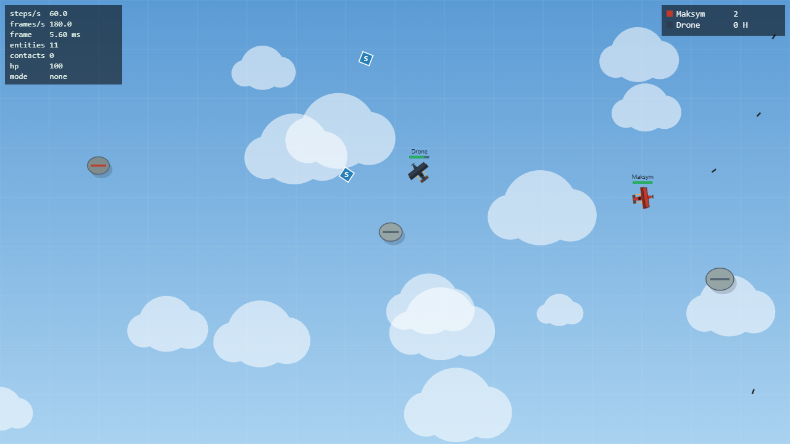

### Що зроблено

| Файл | Зміст |
|---|---|
| `src/sim/vector.js` | `Vector2`: `add`, `sub`, `scale`, `dot`, `length`, `normalize`, `rotate`, `static fromAngle` — **чисті** методи, завжди повертають новий вектор |
| `src/sim/entity.js` | `Entity`: `id` (приватний `#id` + приватний статичний лічильник `static #nextId`), `pos`, `vel`, `angle`, `radius`, `kind`, `alive`, `update(dt)`, `onHit()` |
| `src/sim/entities.js` | `Ship extends Entity` (приватне `#hp`, публічний `get hp()`, `fire()`, `damage()`, респаун через 2 с), `Bullet` (TTL 1.1 с), `Balloon` — аеростат загородження (аналог астероїда), `Pickup`, `Explosion` (частинки) |
| `src/sim/world.js` | `World` поверх `Map<id, Entity>`: `spawn`, `despawn`, `get`, `[Symbol.iterator]`, генератор `*ofKind(kind)`, `step(dt, inputs)` |
| `src/sim/collision.js` | `naivePairs(world)` — генератор пар (a, b), O(n²), окремо від реакції `resolveCollisions`; можна замінити на просторовий хеш з тією самою сигнатурою |
| `src/sim/homing.js` | система наведення над компонентом `entity.homing` |
| `src/sim/rng.js` | `mulberry32` із seed — у симуляції немає `Math.random()` |

Ієрархія — **рівно один рівень**: кожен клас `extends Entity`, глибше нічого немає.

Гравця на арені супроводжує навчальний дрон (темний біплан). Він літає колами і стріляє, коли
гравець опиняється попереду. Дрон — звичайна функція `(ship, world) => controls`, а не підклас.
Кулі збивають і кораблі, і аеростати. Аеростат витримує 3 влучання, а коли лопається, з
імовірністю 50 % лишає бонус. Таран аеростата або іншого літака коштує 34 HP. Збитий
корабель вибухає частинками і через 2 с з'являється в безпечній точці (не ближче 220 од. до кораблів
і аеростатів) з 1.5 с захисту. Рахунок показано на HUD праворуч.

**Цикл `World.step(dt, inputs)`:**
1. Входи потрапляють у кораблі.
2. `update(dt)` кожної живої сутності.
3. Система homing.
4. Пошук пар зіткнень і реакція на них.
5. Додавання сутностей, створених під час кроку.
6. Sweep: видалення мертвих.

Тут два важливі рішення:
- **Відкладений `despawn`.** Він лише ставить `alive = false`, а видаляє запис sweep наприкінці
  кроку. Видаляти з `Map` під час ітерації в JS дозволено, але тоді від порядку вставки залежить, хто
  встиг оновитися в цьому кроці, а хто ні. Для детермінізму (лаба 5) це неприйнятно.
- **Відкладений `spawn` під час кроку.** Ітератор `Map` *бачить* записи, додані під час обходу.
  Без черги `#pending` куля, випущена в цьому кроці, тут же отримала б ще й свій `update` і
  пролетіла б подвійну відстань.

Рендер, як і в лабі 1, інтерполює кожну сутність між `prevPos` і `pos`. `Vector2` незмінний, тож
для `prevPos` достатньо зберегти посилання — копія не потрібна.

### Баг із `this` (і як його виправити)

Наївне підключення клавіші до методу — `?bug=this` у `main.js`:

```js
window.addEventListener("keydown", player.fire);
```

`player.fire` — це просто посилання на функцію з `Ship.prototype`. Об'єкт, через який її
отримали, не запам'ятовується. DOM викликає слухача з `this === currentTarget`, тобто `window`. Що
відбувається всередині `fire()`:
- `this.down` — це `window.down`, тобто `undefined`, перевірка проходить;
- наступний рядок читає приватне поле, і V8 кидає помилку:

```
TypeError: Cannot read private member #cooldown from an object whose class did not declare it
```

(У production-збірці мініфікатор перейменовує поле, і повідомлення має вигляд `… member #t …`. Саме його
зафіксував автоматизований прогін `?bug=this` у Chrome.) Якщо «відірвати» метод від об'єкта і просто викликати його
(`const f = player.fire; f()`), то в модулі (strict mode) `this === undefined` і маємо
`TypeError: Cannot read properties of undefined (reading 'down')`.

Чотири правила `this`:
1. **Звичайний виклик** `f()` → `undefined` (strict).
2. **Виклик методу** `obj.f()` → `obj`.
3. **Явна прив'язка** `f.call(obj)` / `f.apply(obj)` / `f.bind(obj)` → `obj`.
4. **`new F()`** → новий об'єкт.

Стрілочні функції власного `this` не мають і беруть його з місця створення.

**Варіанти виправлення** (перевірено: `?bug=arrow` і `?bug=bind` випускають кулю без помилки):

| Варіант | Код | Плюси / мінуси |
|---|---|---|
| Стрілка-обгортка | `addEventListener("keydown", () => player.fire())` | найпростіше, `this` визначає виклик методу; але кожна обгортка — нова функція, тож для `removeEventListener` треба зберегти посилання |
| `bind` | `addEventListener("keydown", player.fire.bind(player))` | явно; теж створює нову функцію |
| Поле класу зі стрілкою | `fire = () => { … }` у `Ship` | `this` прив'язано назавжди, але функція створюється **для кожного екземпляра** і не лежить на прототипі |
| **Обраний: input як дані** | клавіша лише виставляє `controls.fire = true`; `World.step` сам викликає `ship.fire()` як метод | постріл відбувається *у кроці симуляції*, а не в обробнику події. Це детерміновано, працює з кулдауном і готує ґрунт для лаби 5, де вхід прийде з мережі |

Ще одну пастку зловив сам: спершу рендер передавав у функції малювання `Object.create(entity)` з
підміненою позицією. Але гетер `hp` читає `this.#hp`, а в об'єкта-нащадка приватного поля немає,
тож та сама помилка `Cannot read private member`. Тепер інтерпольовані `pos`/`angle` передаються
окремими аргументами.

### Ланцюжок прототипів — один експеримент

```
Ship (instance) -> Ship.prototype -> Entity.prototype -> Object.prototype -> null
own keys: pos,vel,angle,radius,kind,alive,world,homing,pickup,name,color,thrust,score,down,…
hasOwn fire: false | fire on Ship.prototype: true | update on Entity.prototype: true
typeof Ship: function | s.hp: 100 | s["#hp"]: undefined
```

`class` — синтаксис над функцією-конструктором і прототипами. Методи лежать на прототипі, один
на всі екземпляри; власні в екземпляра лише дані. `#hp` зовсім не є властивістю, тому `s["#hp"]`
дає `undefined` і поле неможливо прочитати ззовні.

### Дизайн-запис: композиція замість дерева класів

Дві фічі, що ламають ієрархію:
- **homing** — має працювати і на кулі, і на аеростаті;
- **pickup** — стоїть на місці, з ним можна зіткнутися, але це не корабель.

**Як виглядала б ієрархія:**

```
Entity
├── MovingEntity
│   ├── Projectile
│   │   ├── Bullet
│   │   └── HomingBullet          ← копія логіки наведення №1
│   ├── Obstacle
│   │   ├── Balloon
│   │   └── HomingBalloon         ← копія логіки наведення №2
│   └── Ship
└── StaticEntity
    └── Collectible
        └── Pickup                ← а якщо аеростат, що лопнув, має «стати» бонусом?
```

Проблеми видно одразу:
- Наведення дублюється у двох гілках, бо кулі й аеростати мають різних предків. Винести його в
  спільного предка неможливо, не зробивши «наводжуваними» всі сутності.
- Комбінації множаться: самонавідна + рикошетна куля означатиме ще класи.
- Поведінку не можна додати під час гри. А бонус «homing» вмикає наведення *кулям, випущеним
  після підбирання*, і для цього довелося б підміняти клас кулі прапорцем.
- Наслідування — це зв'язок «є» (is-a), визначений один раз при створенні. Поведінка ж —
  «має» (has-a) і може змінюватися.

**Що зроблено замість цього — компоненти як дані + системи:**
- `entity.homing = { targetKind, turnRate, range, speed }` — будь-яка сутність з цим полем
  наводиться. `homingSystem(world, dt)` обходить світ і повертає вектор швидкості до найближчої
  цілі (з урахуванням загортання арени).
  - Аеростати-«мисливці» (з червоною смугою) отримують компонент при створенні: повільно, 38 од/с.
  - Кулі отримують його, якщо на кораблі активний ефект `homing`.
  - Класи `Bullet` і `Balloon` про наведення **нічого не знають**.
- `entity.pickup = { effect, duration }` — `resolveCollisions` бачить компонент і віддає пару в
  `pickupSystem`. Той записує ефект у `ship.effects` (`Map` ефект → секунди) і прибирає бонус.
  `Pickup` — лише зручний конструктор: стоїть, обертається, має TTL 15 с.
- Ефекти корабля (`shield`, `rapid`, `homing`) — теж дані, а не підкласи `ShieldedShip`.

Ціна підходу:
- поведінку видно не з класу, а з даних і порядку систем у `World.step`;
- системи доводиться обходити по всьому світу.

Для гри, де кількість сутностей вимірюється сотнями, а нові поєднання поведінок з'являються щолаби,
це вигідний обмін. Плюс компоненти — це звичайні дані, тож їх легко серіалізувати в знімок стану для мережі (лаба 5).
Лишаю `class` там, де справді є спільний життєвий цикл (`update`, `onHit`, `id`), а поведінку,
яку можна змішувати, — у компонентах.

**Контрольний прогін** (Chrome, 25 с автопілота з газом, поворотом і стрільбою, seed 22):

| Подія | Кількість |
|---|---|
| пострілів | 89 |
| влучань | 15 |
| вибухів кораблів | 4 |
| лопнуло аеростатів | 4 |
| підібрано бонусів | 1 |
| помилок у консолі | 0 |

---

## Лабораторна 3. Асинхронний JavaScript: Promises, async/await і екран завантаження

Порядок запуску: **екран завантаження → лобі → гра**.

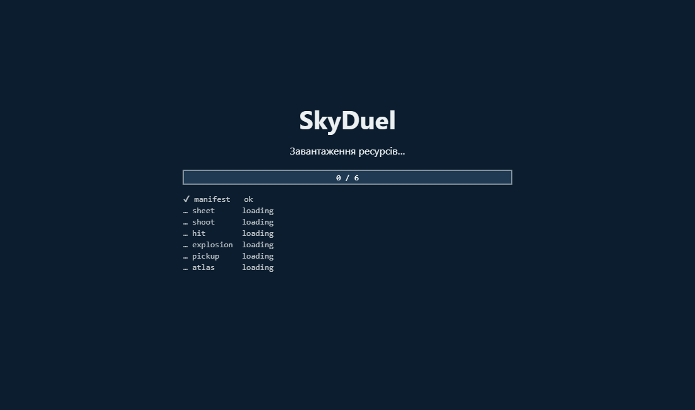 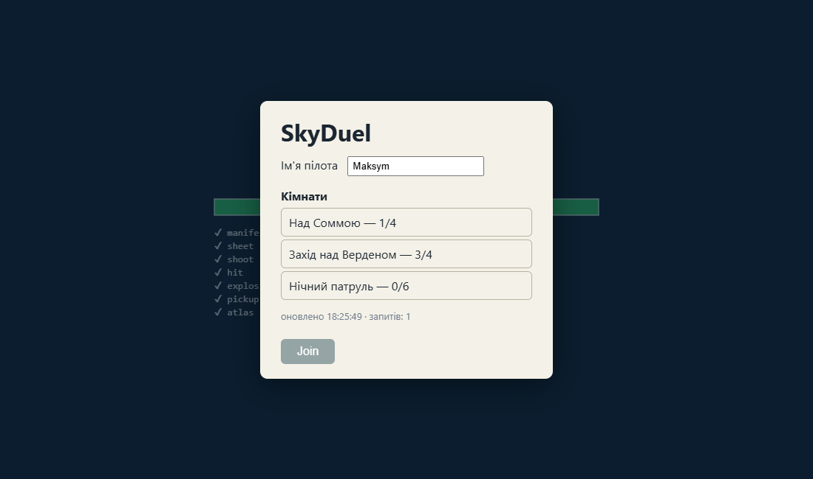

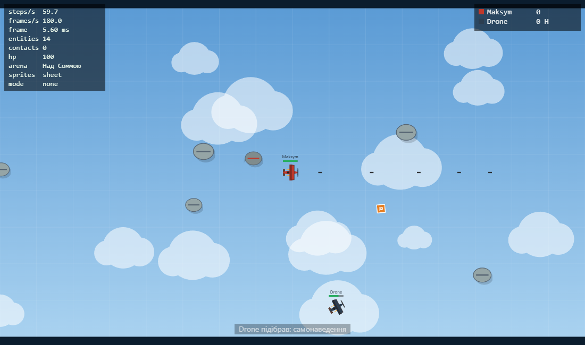

### Що зроблено

| Файл | Зміст |
|---|---|
| `public/assets/manifest.json` | список ассетів: спрайтшит, 4 звуки, атлас спрайтів |
| `src/assets/loader.js` | `fetchOk` (перевіряє `res.ok`, `AbortSignal.any([signal, AbortSignal.timeout(ms)])`), `fetchJson`, `fetchImage` (fetch → Blob → `createImageBitmap`, на відміну від `new Image()` його можна перервати), `fetchAudio` (декодування в `AudioBuffer` ще під час завантаження), `withRetry`, `loadAll` |
| `src/render/loading.js` | екран завантаження на канвасі: справжній прогрес-бар і статус кожного файлу |
| `src/render/sprites.js` | малювання через `drawImage` з прямокутником-джерелом з атласу; якщо спрайтшит не завантажився — векторна графіка з лаб 1–2 |
| `src/audio.js` | Web Audio: `AudioContext`, `resume()` на перший жест гравця, буфери, стерео-панорама за позицією на арені |
| `src/hud.js` | стрічка подій («Maksym ✈ збив Drone», підібрані бонуси) |
| `src/lobby/lobby.js` | `class Lobby extends EventTarget`: `show`/`refresh`/`join`/`leave`, опитування кожні 3 с, таймаут 2 с на запит, abort при виході |
| `src/lobby/lobby-view.js` | DOM лобі; лише слухає події `Lobby` |
| `vite.config.js` | middleware для відтворюваних збоїв: `?lag=мс`, `?status=код` |
| `tools/make-sprites.*`, `tools/make-sounds.py` | спрайтшит рендериться з векторного коду гри, звуки синтезуються |

**`withRetry(fn, { attempts, baseMs, signal })`.** Пауза перед спробою *n* — випадкове число з
`[0, baseMs · 2^(n−1))` (exponential backoff з *full jitter*), тож сотні клієнтів після збою
не почнуть повторювати запити одночасно. Повторюються лише тимчасові збої:
- 5xx і 429;
- `TimeoutError` нашого таймауту;
- мережевий `TypeError`.

**Не** повторюються:
- 4xx — запит неправильний, і повтор нічого не змінить;
- `SyntaxError` битого JSON;
- `AbortError` — гравець сам скасував завантаження.

Пауза теж слухає `signal`, тож скасування перериває і очікування.

**`loadAll`** запускає всі завантаження одночасно через `Promise.all`. Кожен елемент повідомляє
свій стан (`loading → ok | skipped | failed | retry`), тому прогрес-бар показує реальну кількість
готових файлів, а не таймер. Гра стартує лише після `await loadAll(...)`.

Обов'язковий тут лише сам `manifest.json`. Якщо не завантажився спрайтшит, гра малює вектором;
якщо звук — грає беззвучно.

**Шина подій.** `World` має `bus = new EventTarget()`, а `emit()` робить
`dispatchEvent(new CustomEvent(type, { detail }))`. Події: `fired`, `hit`, `exploded`, `popped`,
`pickup`, `respawned`.

`src/sim/**` **не імпортує** ні `audio.js`, ні `hud.js`. Підписуються вони ззовні, у `game.js`.
`EventTarget` і `CustomEvent` є і в Node, тому симуляція лишається переносною (це знадобиться в лабі 5).

**Звук.** `AudioContext` створюється одразу. Через autoplay policy він стартує у стані `suspended`,
але вже дає змогу *декодувати* буфери під час завантаження. `resume()` викликається в першому
`pointerdown`/`keydown` — клік по кімнаті чи «Join» якраз і є таким жестом.

### Sequential `await` vs `Promise.all`

Шість файлів, 5 прогонів кожного режиму в Chrome (`tools/measure-lab3.mjs`). Перемикається через `?load=seq`.

| Умови | Послідовно (`for … await`), медіана | Конкурентно (`Promise.all`), медіана | Прискорення |
|---|---|---|---|
| штучна затримка 150 мс на відповідь (`?netlag=150`) | **961 мс** (942–974) | **170 мс** (166–173) | 5.7× |
| localhost без затримки | 42 мс | 23 мс | 1.8× |

Послідовний варіант платить затримку мережі *за кожен файл*: 6 × 150 мс + декодування ≈ 0.95 с.
Конкурентний платить її один раз, бо всі запити летять паралельно (HTTP/1.1 дозволяє 6 з'єднань
на хост, тут рівно 6 файлів). На localhost виграш менший: домінує не мережа, а декодування
PNG і WAV.

### П'ять головоломок порядку виконання

Виконано в Chrome (`tools/puzzles.mjs`), нижче — реальний вивід.

**1. `await`**
```js
async function a() { log("a1"); await null; log("a2"); }
log("start"); a(); Promise.resolve().then(() => log("then")); log("end");
```
`start, a1, end, a2, then` — тіло `async`-функції до першого `await` виконується синхронно.
Продовження після `await` стає мікрозадачею, поставленою *раніше* за `.then`, тому `a2` іде перед `then`.

**2. `setTimeout` всередині `.then`**
```js
setTimeout(() => log("timeout A"));
Promise.resolve().then(() => { log("then 1"); setTimeout(() => log("timeout B")); })
                 .then(() => log("then 2"));
queueMicrotask(() => log("microtask")); log("sync");
```
`sync, then 1, microtask, then 2, timeout A, timeout B`. Спершу синхронний код, потім **уся** черга
мікрозадач, включно з `then 2`, яку додала `then 1`. Лише після цього задачі в порядку постановки:
`timeout B` поставлено пізніше за `timeout A`.

**3. `requestAnimationFrame`**
```js
requestAnimationFrame(() => { log("raf 1");
  Promise.resolve().then(() => log("raf 1 -> then"));
  setTimeout(() => log("raf 1 -> timeout")); });
requestAnimationFrame(() => log("raf 2"));
setTimeout(() => log("timeout")); Promise.resolve().then(() => log("then")); log("sync");
```
`sync, then, timeout, raf 1, raf 1 -> then, raf 2, raf 1 -> timeout`. rAF — не задача і не
мікрозадача, а крок рендерингу. Тут таймер виконався раніше, бо до кадру лишалося кілька мс (на
180 Гц моніторі кадр кожні 5.6 мс). Мікрозадачі вичерпуються **після кожного** rAF-колбека, тому
`raf 1 -> then` іде перед `raf 2`. А таймер, поставлений у rAF, виконується вже після всіх
колбеків цього кадру.

**4. `async`-функція, що повертає проміс**
```js
async function f() { return Promise.resolve("f"); }
async function g() { return "g"; }
f().then(log); g().then(log);
Promise.resolve().then(() => log("p1")).then(() => log("p2")).then(() => log("p3"));
```
`g, p1, p2, f, p3`. Повернення *промісу* з `async`-функції коштує ще два «тіки» мікрозадач: спершу
`then`-job, щоб прийняти проміс, і лише потім розв'язання зовнішнього промісу. Тому `f` відстає від
`g` на дві ланки ланцюжка. (Висновок: `return await x` і `return x` в async відрізняються не лише
обробкою помилок.)

**5. `dispatchEvent` синхронний**
```js
bus.addEventListener("hit", () => { log("listener 1"); Promise.resolve().then(() => log("listener 1 -> then")); });
bus.addEventListener("hit", () => log("listener 2"));
log("before dispatch"); bus.dispatchEvent(new Event("hit")); log("after dispatch"); await null; log("after await");
```
`before dispatch, listener 1, listener 2, after dispatch, listener 1 -> then, after await`.
`dispatchEvent` викликає слухачів синхронно, прямо всередині поточного стека. Мікрозадача зі
слухача 1 чекає, поки стек спорожніє, тобто після `after dispatch`. Для справжнього кліку
користувача було б інакше: браузер викликає кожного слухача з порожнього стека, і мікрозадачі
вичерпуються *між* слухачами. Для гри це означає, що `world.emit()` під час кроку симуляції
синхронно викликає звук і HUD усередині `World.step`, тож слухачі мають бути дешевими.

### Галерея збоїв

Кожен збій відтворюється параметром у URL і застосовується лише до першої спроби. Тому «Спробувати ще раз»
показує відновлення. Записано `tools/measure-lab3.mjs`, лог консолі — у `docs/lab03/results.json`.

| Збій | Як відтворити | Що відбувається | Результат |
|---|---|---|---|
| **404 спрайтшита** | `?fail=404` | `HttpError 404` → **без повторів** (4xx) → `skipped` | гра стартує, у HUD `sprites: vector fallback` ([лобі](docs/lab03/fail-404-lobby.png), [гра](docs/lab03/fail-404-game.png)) |
| **503 двічі** | `?fail=503` | `retry sheet 1, пауза 174 мс` → `retry sheet 2, пауза 13 мс` → успіх | завантажено за 221 мс, гра зі спрайтами |
| **Таймаут мережі** | `?fail=timeout` (маніфест відповідає за 6 с, таймаут 1.5 с) | 3 спроби по `TimeoutError: signal timed out` з backoff | через **4.97 с** — повідомлення і кнопка; після натискання гра завантажується ([скрін](docs/lab03/fail-timeout.png)) |
| **Abort посеред завантаження** | `?fail=abort` (або **Esc**) | `AbortController.abort()` через 250 мс; усі `fetch` і паузи backoff перериваються; `AbortError` не повторюється | «Завантаження скасовано» + кнопка; повтор успішний ([скрін](docs/lab03/fail-abort.png)) |
| **Битий JSON** | `?fail=badjson` (атлас підмінено на зламаний файл) | `SyntaxError: Expected double-quoted property name…` → без повторів → `skipped` | гра стартує з векторною графікою ([скрін](docs/lab03/fail-badjson-game.png)) |
| Сервер лобі не відповідає | `?fail=rooms` | `TimeoutError` кожні 3 с | лобі показує помилку і продовжує опитування ([скрін](docs/lab03/fail-rooms.png)) |

Спершу маніфест помилково позначав спрайтшит як `required`, і 404 приводив до кнопки повтору
замість fallback. Зловив це саме прогін галереї.

Крім того, якщо зламаний JSON має арена кімнати, `Lobby.join` ловить помилку і запускає гру на
стандартній арені з попередженням у консолі.

### Лобі: опитування й abort під час виходу

`?roomslag=1500` змушує `/api/rooms` відповідати 1.5 с. Тест чекає, поки третій запит опитування
ще в дорозі, і натискає «Join».

| До Join | Після Join (+6 с) |
|---|---|
| запитів: 3 | запитів: **3** (опитування зупинилось) |
| | перервано запитів: **1** (`abort` у `leave()`) |
| | `lobby.active === false` |

Подія `rooms` після старту гри вже не приходить: перерваний запит потрапляє в `catch`, бачить
`signal.aborted` і тихо завершується. Це не помилка, а свідомий вихід.

---

## Лабораторна 4. Node.js: EventEmitter, streams, WebSocket-сервер

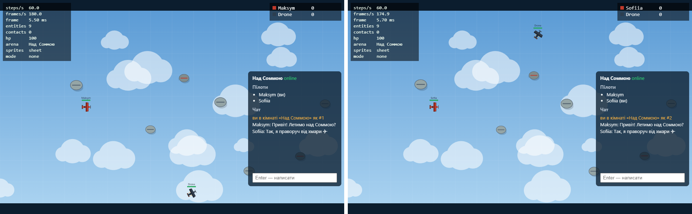

*Два вікна Chrome в одній кімнаті «Над Соммою»: спільний список пілотів і чат. Сам бій поки локальний,
спільний стан з'явиться в лабі 5.*

### Структура

```txt
package.json            # "workspaces": ["client", "server"]
client/                 # Vite-застосунок з лаб 1–3
server/
  src/index.js          # точка входу: конфіг, сигнали, необроблені помилки
  src/app.js            # createApp(): http + ws + кімнати + логи (тести піднімають на порту 0)
  src/config.js         # PORT, HOST, LOG_DIR, STATIC_DIR, ліміти — з process.env, з перевіркою
  src/http.js           # node:http: статика (MIME, захист від ..), /api/rooms, /api/replays, /health
  src/rooms.js          # Room extends EventEmitter; RoomManager
  src/protocol.js       # протокол v0 + parseMessage() (ніколи не кидає винятків)
  src/ws.js             # життєвий цикл сокета, heartbeat, ліміти, політика повільного клієнта
  src/ratelimit.js      # token bucket
  src/log/matchlog.js   # Transform → NDJSON → файл через pipeline
  src/log/replay.js     # async-генератор подій з NDJSON; список повторів
  test/server.test.js   # node:test, 20 тестів
  scripts/              # генератор 200 МБ логу, проба блокування, демо падіння
```

Запуск: `npm run dev` (сервер `:8080` з `--watch` + Vite `:5173` з проксі `/api`, `/health`, `/ws`)
або production-варіант `npm run build && npm start` (сервер сам віддає `client/dist`).

### HTTP

| Маршрут | Що робить |
|---|---|
| `GET /health` | `{ status, uptime, rooms, players, rss }` |
| `GET /api/rooms` | список кімнат з кількістю гравців |
| `POST /api/rooms` | `{ name, maxPlayers? }`. Тіло ≤ 2 КБ (інакше **413**), JSON і поля перевіряються (**400**), ліміт кімнат (**409**) |
| `GET /api/replays`, `GET /api/replays/:id` | список логів матчів і **потокова** віддача файлу |
| `GET /api/stats` | лічильники, пам'ять, event loop utilization |
| усе інше | статика з `client/dist` |

Від виходу за межі каталогу статики захищають два рівні:
1. До будь-якого `path.join` шлях декодується і відхиляється з **400**, якщо містить сегмент
   `..` (зокрема `%2e%2e`, `..%2f`) або `\0`.
2. Для певності отриманий абсолютний шлях мусить починатися з кореня статики (**403**).

Тест шле запити через сирий TCP-сокет, щоб ні `fetch`, ні `new URL` не нормалізували шлях.

**Конфіг з оточення.** `config.js` — єдине місце, де читається `process.env`. Кожне значення
розбирається і перевіряється, а при помилці сервер не стартує і пише зрозуміле повідомлення:
`PORT must be an integer in [0, 65535], got "abc"`. У розробці змінні беруться з
`node --env-file-if-exists=.env` (приклад — `server/.env.example`).

**Коректне завершення.** На `SIGINT`/`SIGTERM` сервер:
1. перестає приймати з'єднання (`server.close()`);
2. шле кожному клієнту `{type:"shutdown"}` і закриває сокет кодом **1001**;
3. закриває кімнати. Кожен лог матчу отримує подію `close`, його `pipeline` дописує файл, і сервер чекає на всі такі
   проміси;
4. виходить з кодом 0. Якщо завершення триває понад 10 с — примусово, з кодом 1.

Інтеграційний тест перевіряє, що клієнт отримав `shutdown` і код 1001. Він також перевіряє, що лог
закінчується подіями `join, chat, leave, close`, тобто нічого не загубилося.

### Кімнати і WebSocket

`Room extends EventEmitter` генерує події:
- `join`, `leave`, `chat`, `empty`, `close`;
- `event` — один нормалізований потік для логу матчу.

`RoomManager` видаляє кімнату на `empty`, якщо вона не постійна. Три стартові кімнати
постійні, а створені через `POST` зникають, щойно з них вийде останній гравець.

**Життєвий цикл сокета (`ws.js`):**

| Правило | Реалізація | Код закриття |
|---|---|---|
| `join` протягом 5 с | таймер на з'єднання | 4003 |
| невідомий тип | `parseMessage` (перевірка через `Object.hasOwn`, тому `"constructor"` чи `"__proto__"` не пройдуть) | 4001 |
| битий JSON / неправильна форма | | 4000 / 4002 |
| завеликий кадр | `maxPayload: 4096` у `ws` | 1009 |
| забагато повідомлень | token bucket, 30/с, сплеск до 60 | 4008 |
| heartbeat | `ping` кожні 15 с, два пропущені `pong` → `terminate()` | 1006 |
| кімната повна / не існує / повторний join | | 4004 / 4005 / 4006 |
| повільний клієнт | `bufferedAmount` > 256 КБ → некритичні (чат) не надсилаються; > 1 МБ → закрити | 4009 |

Критичні повідомлення (`welcome`, `roster`, `pong`, `shutdown`) політика повільного клієнта не відкидає.
**На кожному** сокеті є слухач `"error"`.

**Клієнт `net/connection.js`** — `class Connection extends EventTarget`:
- вхідні повідомлення розсилаються як події з іменем `type`;
- `send()` під час (пере)підключення кладе повідомлення в чергу, яка вивантажується на `open`;
- при неочікуваному закритті повторне підключення з паузою, що росте: 0.5 → 1 → 2 → … ≤ 10 с,
  з «equal jitter»;
- коди протокольних помилок 4000–4006 не повторюються, бо повтор дасть ту саму помилку;
- після перепідключення `join` надсилається знову (обробник `open`).

Чат виводиться лише через `textContent`, бо це неперевірене введення. Поки фокус у полі чату, клавіші не керують
літаком.

**Тести** (`npm test`, усі 20 зелені):
- протокол;
- token bucket з керованим часом;
- автовидалення порожніх кімнат;
- конфіг;
- `Transform` → NDJSON → `readEvents`;
- `/health` і `/api/rooms`, включно з 400/413 на `POST`;
- path traversal;
- два клієнти: join → roster → chat → leave;
- коди 4000, 4001, 4003, 4008, 1009;
- heartbeat (клієнт з `autoPong: false` закривається через ~200 мс при `HEARTBEAT_MS=100`);
- коректне завершення з дописаним логом.

### Логи матчів через streams

```js
const events = on(room, "event", { close: ["close"] });       // async-ітератор подій кімнати
const source = Readable.from((async function* () { for await (const [e] of events) yield e; })());
await pipeline(source, toNdjson(), createWriteStream(`${LOG_DIR}/${room.id}-${stamp}.ndjson`));
```

- `toNdjson()` — object-mode `Transform`: об'єкт на вході → рядок `JSON + "\n"` на виході.
- Опція `close: ["close"]` завершує ітератор, коли кімната закривається. Тоді завершується `Readable`, а `pipeline`
  дописує й закриває файл.
- Помилка будь-якої ланки знищує решту, тож дескриптори не «течуть».
- Слухач підключається синхронно в момент створення кімнати, тому жодна рання подія не губиться.

Повтор віддається тим самим механізмом: `pipeline(createReadStream(file), res)`. Файл у пам'ять не
читається. Для читання на сервері є `readEvents(file)` — async-генератор поверх `readline`. Він
пропускає «порваний» останній рядок, якщо процес вбили посеред запису.

### Backpressure: графік RSS

Згенеровано лог 200 МБ (`server/scripts/make-big-log.js`). Його качав клієнт, який читає не швидше
**5 МБ/с**: відстаючи від бюджету, він робить `res.pause()`. Сервер щочетверть секунди звітував
`rss` (`tools/backpressure-lab4.mjs`).

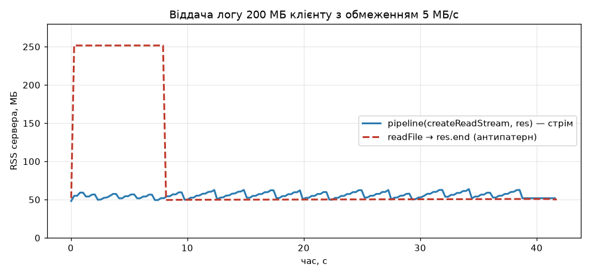

| Спосіб віддачі | Час | RSS на старті | **Пік RSS** |
|---|---|---|---|
| `pipeline(createReadStream(file), res)` | 41.6 с | 48.2 МБ | **63.8 МБ** |
| `res.end(await readFile(file))` (антипатерн, `?mode=buffer`) | 41.7 с | 51.9 МБ | **252.1 МБ** |

Швидкість однакова, бо її визначає клієнт, а пам'ять — ні. Ось як backpressure працює в ланцюжку:
1. Клієнт на паузі, тож TCP-вікно заповнюється.
2. `res.write()` повертає `false`.
3. `pipeline` припиняє читати файл, поки не прийде `drain`.
4. У пам'яті одночасно лише кілька буферів по 64 КБ, тому крива пласка, а ріст на ~15 МБ — це
   heap V8 і буфери сокета.

Антипатерн одразу тримає весь файл (200 МБ) плюс копію в буфері сокета.
Десять таких завантажень одночасно поклали б сервер.

Backpressure є і на стороні запису. Генератор логу чекає `drain`, якщо `write()` повернув `false`.
Без цього він сам накопичив би всі 200 МБ у черзі потоку.

### Записка: цикл подій Node і чому `"error"` без слухача валить процес

**Фази циклу подій libuv** (кожна ітерація):
1. **timers** — `setTimeout`/`setInterval`, чий час настав;
2. **pending callbacks** — відкладені системні колбеки;
3. **poll** — очікування і обробка I/O (нові з'єднання, дані сокетів, файли);
4. **check** — `setImmediate`;
5. **close callbacks** — `'close'` сокетів.

Між *кожними* двома колбеками Node вичерпує `process.nextTick` і мікрозадачі.

**Обробник HTTP, що займає цикл на 300 мс.** Змінна `ENABLE_SLOW_ENDPOINT=1` вмикає `/api/slow` з
`while` на 300 мс. Проба `server/scripts/block-probe.mjs`: WebSocket-клієнт шле `ping` кожні 20 мс,
а інший клієнт тричі викликає `/api/slow`.

| Фаза | ping-RTT p50 | ping-RTT max |
|---|---|---|
| до блокування | 0.4 мс | 0.7 мс |
| під час трьох викликів `/api/slow` | 0.4 мс | **286.7 мс** |
| після | 0.4 мс | 0.5 мс |

Самі запити `/api/slow` тривали 331/302/301 мс. Поки виконується `while`, цикл не дістається фази
poll. Тому сервер не читає нічиїх сокетів: ні пінгів, ні чату, ні нових з'єднань. Не спрацьовують
таймери, не йде heartbeat, а в лабі 5 не буде й кроку симуляції. Пінги не губляться — вони чекають
у буфері ядра і обробляються пачкою, звідси затримка майже на всю тривалість блокування. Одна
синхронна операція на 300 мс — це 300 мс «фрізу» для **всіх** кімнат процесу. Ліки:
- не робити важкої синхронної роботи в обробнику;
- ділити її на шматки (`setImmediate`);
- або виносити у `worker_threads`.

**`"error"` без слухача.** У `EventEmitter` подія `"error"` особлива. Якщо слухача немає, `emit("error")`
**кидає** помилку прямо в місці виклику. Зазвичай це колбек таймера чи I/O, тобто поза
будь-яким `try`, тож маємо `uncaughtException` і процес падає. Демонстрація (`server/scripts/crash-demo.mjs`):

```
server tick… still alive
node:events:505
    throw er; // Unhandled 'error' event
Error: match log disk full
    at Timeout._onTimeout (…/crash-demo.mjs:7:37)
Emitted 'error' event on Room instance at: …
exit code: 1
```

Одна кімната з проблемним логом поклала б **увесь** сервер разом з усіма іншими кімнатами. Виправлення:
```js
room.on("error", (err) => logger.error({ room: room.id, err }, "room error"));
```
Результат:
```
room error logged: match log disk full
other rooms keep playing
exit code: 0
```

Тому `RoomManager` вішає слухача `error` на кожну кімнату, `ws.js` — на кожен сокет, а
`upgrade` — на сирий сокет до рукостискання. Необроблений відхилений проміс з Node 15 так само
завершує процес. `index.js` ловить `uncaughtException`/`unhandledRejection` лише для того, щоб
записати їх у лог зі стеком і завершитися з кодом 1. «Глушити» їх і продовжувати роботу в
невідомому стані не можна, процес має перезапустити супервізор (Docker, лаба 8).

---

## Лабораторна 5. Сервер рахує гру: передбачення, звірка і бінарний протокол


*20 с бою двох вікон Chrome через інжектор мережі: затримка 100 мс, розкид ±15 мс у кожен бік, 2 % втрат.
Пілотами керують клавіатурні сценарії Playwright (`tools/net-lab5.mjs`) — ті самі `keydown`/`keyup`, що й у людини.*

### Архітектура

```txt
shared/                         # третій workspace: БЕЗ DOM і БЕЗ модулів Node
  src/sim/*                     # симуляція з лаб 1–2 (переїхала з client/)
  src/sim/dmath.js              # детерміновані sin/cos/atan2/hypot (див. «баги детермінізму»)
  src/snapshot.js               # takeSnapshot(world, tick), hashSnapshot()
  src/codec/binary.js           # DataView-кодек + специфікація формату
  src/codec/json.js             # JSON-кодек тих самих повідомлень (прапорець ?codec=json)
  src/net/predict.js            # replay() і reconcile() — чисті функції
  src/protocol.js               # перевірка JSON-повідомлень (переїхала з server/)
  test/*.test.js                # 17 тестів, зокрема імпорт без DOM у Node
server/src/match.js             # авторитетний Match: 30 кроків/с, черги input, ack
server/src/netsim.js            # інжектор затримки, розкиду і втрат
client/src/net/netgame.js       # передбачення, звірка, згладжування, інтерполяція
client/src/net/netgraph.js      # netgraph
```

**Сервер — єдиний авторитет.**
- Клієнт шле **лише input** (`{ seq, thrust, turn, fire }`), координат від клієнта не приймаємо.
- `Match` на кожному кроці бере з черги кожного гравця **один** input, робить
  `world.step(1/30, inputs)` і розсилає знімок з персональним `ack` (останній застосований `seq`).
- Вхід перевіряється: бінарний декодер — довжина, версія, біти кнопок, діапазон `turn`; JSON-варіант
  — `protocol.js`.
- Черга обмежена 3 елементами: якщо клієнт шле швидше, ніж йде гра (спроба speed-hack), зайве
  відкидається.
- Повтори через надлишковість відсіюються за `seq`.
- Якщо input не прийшов вчасно, повторюється останнє керування, але **без пострілу**.

**30 кроків/с без `setInterval`.** Кожен крок планується на абсолютний час:
`nextAt += 1000/30; setTimeout(run, nextAt − performance.now())`. Запізнення одного таймера не
накопичується. Тест `match.test.js` перевіряє, що за 1 с проходить 29–31 крок. Тривалість кроку і
запізнення (p50/p99) видно в `GET /api/stats`.

**Seed від сервера.** Його генерує сервер для кожного матчу і надсилає у `welcome`. Симуляція
`Math.random()` не викликає, лише `mulberry32(seed)`.

### Передбачення, звірка, згладжування

На кожному кроці клієнта (1/30 с):
1. Прочитати керування.
2. Надіслати **останні 3** input. Ця надлишковість переживає втрату пакета: без неї кожен
   загублений input — це розбіжність.
3. Застосувати input до свого корабля тим самим `integrate()`, що й на сервері.

На кожному знімку:

```js
const r = reconcile({ server: shipState(mine), ack: snap.ack, pending });  // shared/src/net/predict.js
// = прибрати input з seq ≤ ack, решту програти заново поверх стану сервера
```

Різниця між старим і новим передбаченням і є **величиною поправки**. Вона не застосовується
стрибком: різницю додаємо до візуального зсуву, який згасає експоненційно (τ = 40 мс, тобто за
100 мс лишається ~8 %). Поправки понад 150 од. — це телепорт після респауну, їх не згладжуємо.

**Чужі сутності** малюються в минулому, на `interpDelay` = 100 мс:
- Годинник сервера оцінюється як мінімум `recv − tick·33.3 мс` за останні 60 знімків; мінімум
  відкидає джитер.
- Для `renderTick` знаходяться два знімки, що його охоплюють, і позиції лінійно інтерполюються (з урахуванням
  загортання арени і кута).
- Сутність, що з'явилася, показується з першого знімка, а та, що зникла, — до останнього.
- Затримку можна змінювати наживо клавішами `[` і `]`; брак знімків рахується як `underruns`.

**Свої кулі** з'являються одразу. Клієнт веде локальний кулдаун і створює кулю з ключем `seq`
input-а, яким вона випущена. Сервер записує той самий `seq` у кулю (`Ship.fire` бере `inputSeq`),
тож у знімку видно відповідність. Серверна копія своєї кулі не малюється. Локальна прибирається,
коли сервер її підтвердив, а потім вона зникла зі знімка (влучання), або якщо підтвердження немає довше RTT + 300 мс.

**Netgraph** (знизу ліворуч) показує:
- RTT (ping/pong кожні 500 мс);
- вік знімка і знімків/с;
- КБ/с вниз і вгору, байтів на знімок;
- кількість непідтверджених input;
- поточну поправку і максимум за секунду;
- затримку інтерполяції і `underruns`;
- кодек і налаштування інжектора;
- стовпчики поправок, по одному на знімок: червоний означає поправку > 0.1 од.

Інжектор мережі задається параметрами URL і діє на сервері для конкретного з'єднання:
`/?lag=100&jitter=30&drop=0.02`.
- `lag` — додатковий RTT: половина в кожен бік.
- `jitter` — ±половина в кожен бік.
- `drop` — втрата input і знімків. Керуючі повідомлення не губляться, як і в TCP.
- Порядок доставки зберігається, тому розкид проявляється як «пачки», а не як перестановка.

### Що показав netgraph

**Відгук на клавішу** — від `keydown` до моменту, коли кут *показаного* корабля почав змінюватися.
10 вимірювань на кожен варіант, `tools/latency-lab5.mjs`:

| Режим | Без затримки | `lag=100` |
|---|---|---|
| без передбачення (`?predict=0`): корабель рухається лише після знімка | 93 мс | **204 мс** |
| з передбаченням | 32 мс | **32 мс** |

Без передбачення 100 мс лагу відчуваються одразу: літак «пливе» за клавішами. Навіть без
лагу набігає 93 мс: очікування кроку клієнта (до 33 мс) + черга сервера + крок сервера + доставка
знімка. З передбаченням відгук обмежує лише крок симуляції 30 Гц (≤ 33 мс), **незалежно від лагу**.

**Поправки** — 12 с бою двох гравців, `lag=100, jitter=30, drop=2 %`, по 120 знімків на гравця:

| Прогін | RTT | поправка p50 | p95 | max | знімків з поправкою > 0.01 |
|---|---|---|---|---|---|
| детермінована симуляція | 127–136 мс | **0.00008** | 0.0006 | 0.0007 | **0 / 120** |
| `Math.random()` в `integrate` (`?chaos=1`) | 112–120 мс | **0.12** | 0.65 | 1.0 | **85 / 120** |

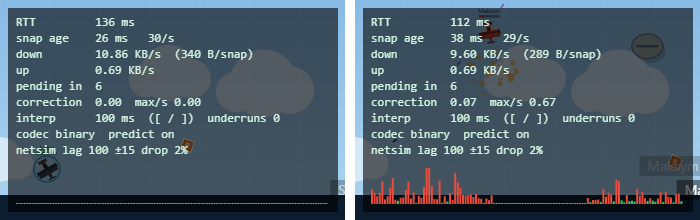

Ліворуч поправки ≈ 0, і стовпчики зелені. Залишок 0.0001 — це округлення координат до `float32`
у знімку. Праворуч `±10 %` випадкового шуму тяги в `integrate` (`SIM_FLAGS.chaos`) робить
передбачення клієнта і результат сервера різними, тож поправка з'являється майже на кожному знімку
(червоні стовпчики). Згладжування ховає ривки, але корабель помітно «тремтить». Після
експерименту прапорець вимкнено, а тест `Math.random in integrate breaks it` фіксує це явище в CI.

В одному з перших прогонів зловив поправку **449 од.** Це респаун після збиття: сервер переніс
корабель у безпечну точку, а клієнт не міг цього передбачити. Тому поправки понад 150 од.
застосовуються без згладжування.

Підтверджено і роль надлишковості: з 2 % втрат пакетів поправки лишилися нульовими. Загублений input
доходить у наступному пакеті, і сервер застосовує його вчасно.

### Баги детермінізму, які я зловив

1. **Глобальний лічильник id.** У лабі 2 `Entity` мав `static #nextId`. На сервері кілька
   кімнат в одному процесі, тож id залежали від того, що встигли створити *інші* кімнати. Той самий seed
   і ті самі input давали різні id. Тепер id видає `World` (`#nextId` на світ), а `#id` сутності
   лишився приватним і записується один раз. Тест: `entity ids are per world`.
2. **`Math.sin` у Node і в Chrome — різні!** Скрипт з 1000 кроків з однаковим seed і input дав хеш
   стану `d1ae1516` у Node 26 (V8 14.6) і `87ae282a` у Chrome 156. Пошук першого розходження
   (`tools/probe-compare.mjs`) показав розбіжність уже на 10-му кроці. Побітове порівняння
   функцій:

   | `Math.*` | Node 26 vs Chrome 156 |
   |---|---|
   | `sin`, `cos`, `atan2`, `exp` | **різні останні біти** |
   | `hypot`, `imul`, `sqrt`, `+ − × ÷` | однакові |

   Специфікація ECMAScript вимагає від трансцендентних функцій лише «implementation-approximated»
   значення, а IEEE 754 гарантує точність тільки для `+ − × ÷ sqrt`. Тому `shared/src/sim/dmath.js`
   реалізує `dsin`/`dcos` (Cody–Waite редукція + поліном), `datan2` (ряд Тейлора після редукції) і
   `dhypot` (через `sqrt`) **лише на точно визначених операціях**. Точність — 1e-12 (тест
   `dmath.test.js`). Після заміни хеш **`67781646` однаковий у Node і в Chrome**
   (`tools/determinism-browser.mjs` + `shared/src/determinism.js`). Для локальної гри це
   непомітно, але без цього два різні браузери однієї кімнати поступово розходились би з сервером.

### Бінарний протокол

Специфікація — коментар на початку `shared/src/codec/binary.js`. Коротко:
- **little-endian** скрізь;
- байт типу і **байт версії**;
- кут — `Int16` у 1/10 000 рад;
- координати і швидкості — `Float32`;
- input — 6 байтів (`u32 seq`, біти кнопок, `i8 turn`);
- знімок — заголовок 12 байтів + 22 байти на сутність + 1–6 байтів залежно від `kind`.

Декодер сам перевіряє довжину, версію, `kind`, кінечність чисел і точну відповідність
довжини. Будь-яка помилка — `CodecError`: сервер закриває сокет з кодом 4002, клієнт відкидає знімок.
`binaryType = "arraybuffer"`. На сервері `Buffer` читається через `DataView(buf.buffer, buf.byteOffset, …)`,
бо `ws` дає зріз зі спільного пулу, і `new DataView(buf.buffer)` без зсуву читав би чужі байти
(є тест на зріз зі зсувом).

**JSON проти бінарного** — 4 гравці, 30 Гц, 10 с, реальний сервер (`server/scripts/codec-bench.mjs`):

| Кодек | Байтів на знімок | КБ/с на клієнта (вниз) | КБ/с на клієнта (вгору) | encode + decode, мкс |
|---|---|---|---|---|
| JSON | 3 727 | 109.6 | 3.76 | 33.6 |
| **Бінарний (`DataView`)** | **506** | **14.9** | **0.44** | **5.5** |
| виграш | 7.4× | 7.4× | 8.6× | 6.1× |

Мікробенчмарк: знімок з 29 сутностей, 20 000 повторів після прогріву JIT. JSON — це
`JSON.parse(JSON.stringify())`, бінарний — `decodeSnapshot(encodeSnapshot())`.
Стрибок у байтах дають три речі:
- назви полів, які JSON повторює для кожної сутності;
- десяткові рядки на зразок `"x":1234.5678901234`;
- кут: 2 байти замість ~18 символів.

Вгору виграш ще більший: input з трьох записів займає 21 байт проти ~180 символів JSON.

### Записка: мережевий код

**Три проблеми і як їх розв'язано:**
1. **Затримка.** Без передбачення відгук = RTT + черга + крок (204 мс при `lag=100`). Свій корабель
   передбачається тим самим `integrate`, і відгук падає до ≤ 33 мс незалежно від RTT. Чужі кораблі
   показуються зі зсувом у минуле і інтерполюються: так вони плавні при 30 знімках/с і розкиді ±15 мс.
2. **Узгодженість.** Сервер — єдине джерело правди. Клієнт звіряється з кожним знімком через `ack`
   і повторно програє непідтверджені input. Щоб звірка давала нуль, симуляція мусить бути
   *побітово* детермінованою. Звідси:
   - seed від сервера;
   - id на світ;
   - відсутність `Math.random`/`Date.now`;
   - фіксований `dt`;
   - власна тригонометрія.
3. **Чити.**
   - Клієнт не надсилає координат, тож «телепорт» неможливий.
   - `turn` обмежений [−1, 1], кнопки — двома бітами, і це перевіряє декодер.
   - Черга input обмежена 3, тому швидше за 30 Гц керувати не вийде.
   - Кулдаун пострілу рахує сервер.
   - Ліміт повідомлень (token bucket) і розміру кадру лишилися з лаби 4.
   - Чого це **не** закриває: aimbot (клієнт знає позиції всіх) і «wallhack» (знімок містить усі
     сутності арени). Для арени без укриттів це прийнятно.

**Обрана затримка інтерполяції — 100 мс** (3 інтервали знімка):
- 66 мс (2 інтервали) не вистачає при розкиді ±15 мс і 2 % втрат: один загублений знімок означає, що
  `renderTick` виходить за останній знімок (`underrun`), і чужий літак на мить зупиняється.
- 100 мс переживає втрату одного знімка поспіль, і в 12-секундних прогонах `underruns = 0`.
- Ціна: суперника видно на ~100 мс + RTT/2 у минулому. Сервер перевіряє влучання в *теперішньому*
  стані, тож по швидкому літаку інколи доводиться брати упередження. Компенсація лагу
  (сервер «відмотує» світ на час, який бачив стрілець) — це Stretch-задача, вона не реалізована.

### Тести

`npm test` запускає `shared` (17) і `server` (23) — **40 тестів**:
- імпорт `shared` у Node без DOM;
- детермінізм 1000 кроків (дві копії світу → однакові хеші й однаковий знімок);
- `chaos` ламає детермінізм;
- `reconcile` як чиста функція:
  - правильний стан сервера відтворює передбачення;
  - поправка сервера зсуває результат рівно на свою величину;
- кодек:
  - round-trip з допуском квантування;
  - `Buffer` зі зсувом;
  - биті буфери → `CodecError`;
  - round-trip input;
  - бінарний ≥ 4× менший за JSON;
- `Match`:
  - дедуплікація надлишкових input і `ack`;
  - ліміт черги;
  - точний таймер;
- точність `dmath`.

---

## Лабораторна 6. TypeScript для протоколу і симуляції

Усі три пакети тепер на TypeScript у режимі `strict` + `noUncheckedIndexedAccess`.

| Показник | Значення |
|---|---|
| `npm run typecheck` | 0 помилок у `shared/` (src + tests), `server/`, `client/` (+ `vite.config.ts`) |
| `any` | **0** |
| приведень `as` | **1** (`shared/src/types.ts`, створення branded-типу, з коментарем); `as const` — не приведення |
| тести | 18 (`shared`) + 24 (`server`) = **42**, усі зелені |
| детермінізм | хеш скриптового матчу `c82272da` однаковий у Node і в Chrome; 5000 кроків TS-версії **побітово** збігаються з JS-версією `lab-05` |
| CI | `.github/workflows/ci.yml`: `npm ci` → `typecheck` → `lint` → `test` → `build` на кожен push і PR |

### Як влаштовано

**Конфіги:**
- `tsconfig.base.json`: `strict`, `noUncheckedIndexedAccess`, `verbatimModuleSyntax`, `erasableSyntaxOnly`,
  `allowImportingTsExtensions`, `noEmit`, `module: nodenext`.
- Кожен пакет має власний `tsconfig.json`; клієнт використовує `module: preserve` / `moduleResolution: bundler`.
- `vite.config.ts` перевіряється окремим `tsconfig.node.json`, щоб Node-глобали (`process`, `Buffer`)
  не потрапили в браузерний код.

**Без збірки:**
- **Сервер** запускається просто `node src/index.ts`: Node 22.18+/24 сам знімає типи. Тому
  `erasableSyntaxOnly` забороняє все, що не можна просто стерти: `enum`, `namespace`, параметри-властивості.
- **Клієнт** — Vite. TypeScript тут лише перевіряє (`tsc --noEmit`), а не компілює.

**`shared/` без DOM і без Node — тепер це гарантує компілятор.** У `shared/tsconfig.json` лише
`lib: ["es2023"]` і `types: []`, а `src/env.d.ts` оголошує тільки те, що однаково є в обох
середовищах: `EventTarget`, `CustomEvent`, `AbortSignal`, `TextEncoder/Decoder`. Згадка `document`
чи `Buffer` у симуляції — помилка `tsc`.

**Branded-типи** (`shared/src/types.ts`): `EntityId`, `Tick`, `Seq`, `PlayerId`.
- Під час виконання це звичайні `number`, але передати `seq` туди, де чекають `EntityId`, — помилка компіляції.
- Створити branded-значення можна лише через `entityId(n)`, `seq(n)`, … Їх викликають довірені
  джерела: лічильник `World`, декодер після перевірки діапазону, Zod після валідації (`.transform(seq)`).

**`readonly`:**
- `Vector2` має `readonly x, y`;
- знімок (`Snapshot`, `EntityData`) повністю `readonly`;
- вхід — `readonly Input[]`.

**Сутності знімка** — об'єднання з полем `kind`: `ShipData | BulletData | BalloonData | PickupData`.
Так само й класи симуляції: `AnyEntity = Ship | Bullet | Balloon | Pickup | Explosion`,
`readonly kind = "ship"`. `world.ofKind("bullet")` повертає `Generator<Bullet>`, а не `Entity`.

**Протокол** (`shared/src/protocol.ts`) — єдине джерело правди:
- Схеми Zod для кожного повідомлення в обидва боки. Типи виводяться зі схем:
  - `ClientMessage = z.infer<…>` — що сервер отримає після розбору;
  - `ClientMessageIn = z.input<…>` — що клієнт може надіслати.
- `parseClientMessage(data: unknown)` і `parseServerMessage(data: unknown)` **ніколи не кидають винятків**,
  а повертають `Result<T, { code, reason }>`. Сервер записує помилку в лог і закриває сокет з кодом
  (4000/4001/4002), як у лабі 4.
- Ручний валідатор лаби 4 видалено.
- Клієнт тепер теж перевіряє **кожне** повідомлення сервера: раніше це був голий `JSON.parse`.

**Кодеки** реалізують спільний інтерфейс `Codec` (`binaryCodec`, `jsonCodec`).
- Бінарний декодер сам перевіряє довжину, версію, `kind`, кінечність чисел, діапазон кута і точну
  довжину кадру.
- JSON-кодек перевіряє знімок схемою Zod.

**Вичерпні `switch`.** Кожен `switch` по `type` або `kind` має `default: assertNever(x)`:
- обробник повідомлень клієнта на сервері;
- `takeSnapshot`, бінарний енкодер і декодер;
- `deriveEvents` і рендер мережевої гри;
- рендер локальної гри.

Новий тип повідомлення чи сутності без гілки — це помилка `tsc`.

**Сервер і клієнт:**
- `Room extends EventEmitter<RoomEvents>` і `RoomManager extends EventEmitter<ManagerEvents>`:
  `room.on("chat", (player, text) => …)` знає типи аргументів.
- Подій симуляції, лобі і з'єднання передаються через типізовану `Bus<Events>` (`shared/src/bus.ts`).
- Конфіг з оточення проходить через одну схему Zod (`ConfigSchema` → `ServerConfig`): коерція,
  діапазони, значення за замовчуванням.
- Кожен `catch` має `err: unknown`; для логів є `errFields(err)` і `errMessage(err)`.
- Відповідь `POST /api/rooms`, атлас спрайтів, маніфест, список кімнат і конфіг арени —
  усе приходить по мережі як `unknown` і проходить Zod до використання.

### Що знайшов TypeScript (і чого не знайшов)

1. **`Map.get` без перевірки.**
   - `Bullet.onHit` робив `world.get(this.ownerId)` і передавав результат у `damage()` як
     «атакувальника». Якщо стрілець уже вийшов (його корабель прибрано), у JS це був `undefined`,
     і рахунок тихо не нараховувався нікому. Тепер тип `AnyEntity | undefined` змушує явно
     перевірити `owner?.kind === "ship" ? owner : null`.
   - Подібне знайшлося в 6 місцях клієнта: `buffer[i - 1]`, `explosions[0]`, `feed.at(-1)` під
     `noUncheckedIndexedAccess`.
2. **`rng.pick([])` повертав `undefined`.** Тепер `pick<T>(items: readonly T[]): T` кидає `RangeError`.
3. **Сентинел `0` замість «немає атакувальника».** Події `hit` і `exploded` мали `by: attacker?.id ?? 0`.
   Із branded `EntityId` нуль — не id, тож компілятор не пропустив, і тепер там `EntityId | null`.
   Кілл-фід перевіряв `by ? … : …` і з нулем працював випадково.
4. **Monkey-patching `ws.state`.** Сервер дописував власне поле в об'єкт `WebSocket`, і TS
   цього не дозволив. Стан з'єднання переїхав у `Map<WebSocket, Conn>`, а при закритті сокета
   запис видаляється. Раніше він жив, доки жив об'єкт сокета.
5. **Необроблене `null`.**
   - `document.getElementById("game")` міг повернути `null`. Тепер є `$(root, "#game", HTMLCanvasElement)`
     з перевіркою `instanceof`.
   - `canvas.getContext("2d")` теж міг повернути `null`.
   - `req.url` в `node:http` має тип `string | undefined`.
6. **Помилки невідомої форми.** У `catch (err)` код читав `err.code === "ENOENT"`, `err.name`,
   `err.message`. Під `unknown` довелося звужувати: `err instanceof Error && "code" in err`. Колбек
   `isRetryable` перевіряв `err?.name === "TimeoutError"`, а тепер `err instanceof DOMException`.
7. **Розбіжності форми між пакетами.** Тести лаби 4 створювали `room.join({ id, name })`, а з лаби 5
   кімнаті потрібні ще `ws`, `shipId` і `color`. Тип `RoomPlayer` показав, що фейки в тестах застаріли.
8. **Чого TS НЕ знайшов — `this`.** `Ship.fire(this: Ship)` тепер оголошує свій receiver.
   Від'єднаний виклик `const f = player.fire; f()` дає помилку **TS2684**, але
   `window.addEventListener("keydown", player.fire)` **компілюється без помилки**. TypeScript
   порівнює `this` слухача DOM (`Window`) і методу бівалентно. Баг лаби 2 типи ловлять лише
   частково (`?bug=this` усе ще відтворює його). Лікує цей баг архітектура (input як дані), а не
   компілятор.

**Що зловили тести і перевірки, а не типи** (теж під час міграції):
- **Регресія детермінізму.** `World.#spawnPickups` переписав як
  `new Pickup({ pos: this.findSafeSpot(120), effect: this.rng.pick(EFFECTS) })`. Порядок обчислення
  властивостей поміняв місцями два виклики seeded-генератора, і **всі** матчі після першого бонусу
  стали іншими. Типи тут безсилі (обидва варіанти коректні), а покрокове порівняння з JS-версією `lab-05`
  показало розбіжність на 180-му кроці. Виправлено і закріплено тестом «золотий хеш» `c82272da`.
- **Переповнення кута.** Під час типізації декодера додав перевірку діапазону кута. Вона виявила, що
  бонус, який обертається, має кут, що росте без меж. Після ~3.27 рад `setInt16` тихо обрізав
  значення до сміття. Тепер `takeSnapshot` нормалізує кут.

### Три типи простими словами

**1. `Brand<T, B>`** — «число з паспортом».

```ts
declare const brand: unique symbol;
type Brand<T, B extends string> = T & { readonly [brand]: B };
type EntityId = Brand<number, "EntityId">;
type Seq = Brand<number, "Seq">;
```

У рантаймі `EntityId` і `Seq` — звичайні числа, а поле `[brand]` не існує. Але компілятор вважає,
що в кожного «паспорт» свій, тож `world.get(input.seq)` не скомпілюється. Отримати такий тип можна лише
через функцію-«паспортний стіл» (`seq(n)`). Це і є єдине `as` у проєкті.

**2. Об'єднання з полем `kind` + `assertNever`.**

```ts
type EntityData = ShipData | BulletData | BalloonData | PickupData; // у кожного свій kind
switch (e.kind) {
  case "ship":   e.hp; break;          // тут e — ShipData
  case "bullet": e.owner; break;       // тут e — BulletData
  case "balloon": case "pickup": break;
  default: assertNever(e);             // сюди можна потрапити лише якщо e: never
}
```

Перевіривши `kind`, TypeScript знає, яка це сутність, тож `e.owner` у кулі можна, а в аеростата
не можна. `default` приймає лише `never`, тобто «тут не може бути нічого». Якщо додати
`| MineData`, компілятор покаже кожен `switch`, який забув про міни.

**3. `ServerMessageOf<T>` і `Bus<Events>`** — подія, що знає свій вміст.

```ts
type ServerMessage = z.infer<typeof ServerMessageSchema>;          // тип виведено зі схеми
type ServerMessageOf<T extends ServerMessage["type"]> = Extract<ServerMessage, { type: T }>;
conn.on("chat", (m) => m.text);        // m: ServerMessageOf<"chat">
conn.on("roster", (m) => m.players);   // m: ServerMessageOf<"roster">
```

Одна схема Zod дає і перевірку в рантаймі, і тип. `Extract` «вирізає» з об'єднання варіант з потрібним
`type`, тож обробник `chat` бачить `text`, а обробник `roster` — `players`. `Bus<Events>` робить те
саме для внутрішніх подій: `bus.emit("hit", { target })` без поля `hp` — помилка компіляції.

### Фреймворк для лобі та HUD: не взяв

Лобі — це ~120 рядків DOM (список кімнат, поле імені, кнопки). Панель кімнати — ~100 рядків.
HUD малюється на канвасі. Стан цих екранів простий і вже типізований:
- `Bus<LobbyEvents>`;
- `conn.on(...)`;
- типобезпечний `$()` замість `querySelector`.

Svelte/Vue/React дали б декларативний рендер списку і реактивність. Але ціною ще одного
компілятора у Vite, ще однієї моделі життєвого циклу поруч із ігровим циклом на rAF і +30–45 КБ
бандла (React + ReactDOM gzip ≈ 45 КБ). А головне — екрани, де фреймворк реально допоміг би,
у цій грі займають 5 секунд до старту бою. Поточний бандл — 148.8 КБ (47.3 КБ gzip), і найбільша
його частина тепер Zod. Тому якщо щось і оптимізувати, то перейти на `zod/mini`, а не додавати
фреймворк.

---

## Лабораторна 7. Рушій, пам'ять і тести

[](https://github.com/DeorixProg/skyduel/actions/workflows/ci.yml)

### Тести

`npm test` — це Vitest у трьох пакетах (`vitest.config.ts`, `projects: shared / server / client`):
**91 тест**, усі зелені.

| Пакет | Файли | Що перевіряється |
|---|---|---|
| `shared` (52) | `sim.test.ts`, `shared.test.ts`, `properties.test.ts`, `dmath.test.ts` | `Vector2`, `integrate` (тяга, поворот, опір, ліміт швидкості, загортання), колізії (дотик, перекриття, промах, через край арени, **тунелювання**), влучання кулі, бонус через компонент, відкладений `despawn`, респаун, детермінізм (золотий хеш `c82272da`, дві копії світу на 1000 кроків, просторовий хеш ≡ naive), `reconcile` як чиста функція, кодеки, протокол, пул, шина, бот, `dmath` |
| `server` (25) | `server.test.ts`, `match.test.ts` | протокол Zod, token bucket з керованим годинником, кімнати, NDJSON-логи, конфіг, heartbeat, HTTP і path traversal, два клієнти + чат, коди закриття 4000/4001/4003/4008/1009, коректне завершення, черга input і `ack`, точний таймер, боти й автовидалення кімнат лише з ботами |
| `client` (14) | `client.test.ts` (happy-dom) | ігровий цикл з **фейковим rAF-годинником** (60 кроків/с на 144 Гц, обмеження 0.25 с, `alpha`) і фейковими таймерами `vi.useFakeTimers` (режим `setInterval`), `justPressed`/`blur`, політика повторів, `Connection` з фейковим WebSocket (черга, backoff, без повторів на 4001, перевірка вхідних повідомлень), опитування лобі й зупинка після `leave`, кільцевий `Recorder`, netgraph |

**Властивості fast-check** (`shared/test/properties.test.ts`) — 7 штук:

| # | Властивість | Прогонів |
|---|---|---|
| P1 | бінарний знімок після `decode(encode())` збігається з точністю до квантування (кут ±0.5/10 000 рад, координати — точно для `float32`) | 300 |
| P2 | довжина закодованого знімка та input **завжди** дорівнює формулі зі специфікації | 100 + 100 |
| P3 | довільні байти (2000 прогонів) і **одиничні мутації валідного кадру** дають `CodecError` або коректне повідомлення — жодного іншого винятку | 2100 |
| P4 | корабель лишається в арені після 1000 випадкових кроків input | 50 × 1000 |
| P5 | `parseClientMessage` приймає кожне згенероване валідне повідомлення і відхиляє його мутації (невідомий тип, обрізаний JSON, масив, `../` в імені кімнати, порожній чат…) | 100 + 100 |
| P6 | JSON-кодек повертає той самий знімок | 100 |
| P7 | просторовий хеш знаходить **рівно ті самі пари в тому самому порядку**, що й naive O(n²), для будь-якого розміщення | 200 |

fast-check одразу знайшов дві речі:
- **P6 на другому прогоні:** `JSON.stringify(-0) === "0"`, тож швидкість `-0` повертається як `+0`. Для гри це нешкідливо, але `deepEqual` порівнює через `Object.is`. Властивість тепер порівнює серіалізовані рядки, а сам факт задокументовано.
- **Тест «куля влучає в корабель»** (звичайний unit) спершу падав. Я поставив стрільця на 30 од. від цілі, кораблі таранили один одного (−34 HP), і HP цілі виходило не 75, а 41. Модель працювала правильно, помилився тест.

**Покриття `shared/`** (`npm run coverage`, поріг 85 % стоїть у конфігу і валить CI):
- рядки **95.9 %**;
- інструкції 93.7 %;
- функції 93.1 %;
- гілки 85.2 %.

**E2E** (`e2e/two-players.spec.ts`, Playwright, `webServer` піднімає справжній сервер):
- два браузерні контексти заходять в одну кімнату, і в обох видно двох пілотів;
- перший тримає W, другий бачить рух його корабля: **за 107 мс** (умова — ≤ 500 мс);
- повідомлення чату з першого вікна з'являється в другому.

**CI** (`.github/workflows/ci.yml`) на кожен push і PR:
1. `typecheck`;
2. `lint` (Biome з type-aware правилом `noFloatingPromises` — у коді плаваючих промісів не знайшлося, бо з лаби 6 скрізь стоїть `void`/`await`);
3. `test`;
4. `coverage`;
5. `build`;
6. Playwright Chromium;
7. `e2e`.

### Профілювання клієнта: до і після

**Як міряли.** `tools/profile-lab7.mjs` створює кімнату, додає **8 серверних ботів** (`POST /api/rooms/:id/bots`) і заходить
гравцем. 30 с гравець тримає газ і стріляє, повертаючи то вліво, то вправо. Одночасно записуються:
- тривалість кожного кадру — кільце `Float64Array` у `Recorder`;
- трас Chrome з подіями `MinorGC`/`MajorGC`;
- семплювальний heap-профайлер **з урахуванням уже зібраних об'єктів** (`includeObjectsCollectedBy*GC`): так видно, хто створює сміття, а не лише що живе наприкінці;
- CPU-профіль, з якого будується flame graph (`tools/flamegraph.py`).

«До» — це клієнт тегу `lab-06`, запущений на тому самому сервері (порт 8081). Обидва прогони зроблено при звичайній
швидкості CPU, монітор 180 Гц. `performance.mark/measure` навколо `simulate`, `render`, `decode` і `reconcile`
вмикаються через `?perf=1` окремим прогоном, бо самі записи `measure` накопичуються в пам'яті й
спотворюють картину GC.

| Показник (30 с, 8 ботів) | До (lab-06) | Після |
|---|---|---|
| кадр p50 / p95 / p99 | 5.6 / 5.8 / 6.0 мс | 5.6 / 5.8 / 6.0 мс |
| найдовший кадр | **55.5 мс** | **9.1 мс** |
| **сміття за 30 с** (усі алокації) | **125 МБ** | **55 МБ** |
| minor GC (кількість / сумарно / макс.) | 20 / 14.7 мс / 1.1 мс | 25 / 15.0 мс / 1.2 мс |
| major GC (кількість / сумарно / макс.) | 20 / 44.4 мс / 3.9 мс | 19 / 35.7 мс / 3.0 мс |
| зайнятість головного потоку (CPU-профіль) | 1649 мс | **966 мс** (−41 %) |
| `render`, середнє на кадр (`?perf=1`) | 0.554 мс | 0.381 мс |
| топ-3 алокатори | `sampleRemote` 27 МБ, `render` 19 МБ, `draw` (netgraph) 12 МБ | `render` 19 МБ, `decodeSnapshot` 6.7 МБ, `sampleRemote` 4.2 МБ |
| топ-3 за власним часом | `fillText` 510 мс, `fillRect` 116, `drawImage` 98 | `drawImage` 194 мс, `fillText` 67, `render` 62 |

Під 4× сповільненням CPU (`Emulation.setCPUThrottlingRate`) кадр p99 8.5 → **7.9 мс**, найдовший
кадр 19.7 → 17.1 мс, а найдовша пауза major GC **14.1 → 8.9 мс**.

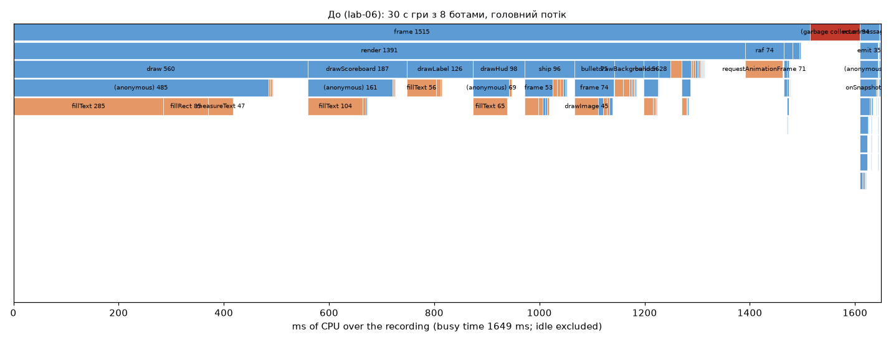
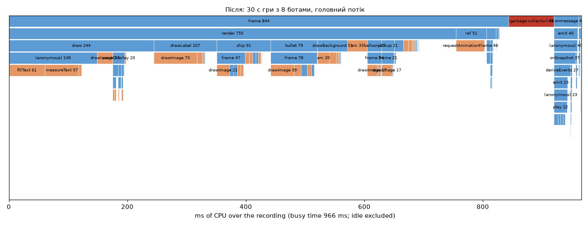

*Агрегований flame graph головного потоку за 30 с (простій виключено), ширина — сумарний час.
«До»: `draw` netgraph (560 мс, майже все — `fillText`), `drawScoreboard` (187), `drawLabel` (126), `drawHud` (98).*

**Що виправлено — кожен пункт за вимірюванням:**

1. **Текст.**
   - Проблема: `fillText` займав 31 % усього часу. Netgraph, HUD і таблиця рахунку перемальовувались 180 разів на секунду, хоча їхні цифри
     змінюються рідко.
   - Рішення: тепер вони малюються в offscreen-шар 4 рази на секунду (`render/overlay.ts`), а кожен
     кадр — це один `drawImage`. Імена над літаками растеризуються один раз (кеш `nameBitmap`).
   - Результат: `fillText` 510 → 67 мс.
2. **Інтерполяція без об'єктів.**
   - Проблема: `sampleRemote` створював нову `Map` і копію `{...entity}` для кожної сутності в кожному кадрі (27 МБ).
   - Рішення: тепер `remote: Map<EntityId, RemoteView>` перевикористовує ті самі об'єкти, а стара позиція «підмітається» за номером кадру.
   - Результат: 27 → 4.2 МБ.
3. **Пули.**
   - Частинки вибухів і передбачені кулі клієнта беруться з `Pool` (`shared/src/pool.ts`).
   - Частинки — це один плаский масив із swap-remove замість масиву на кожен вибух.
   - На сервері частинки `Explosion` теж з пулу. Золотий хеш не змінився: ті самі виклики `rng` у тому самому порядку.
4. **Дрібні алокації в гарячому циклі:**
   - `for (const [id, e] of map)` створює масив `[k, v]` на кожен запис — замінено на `.values()` + `e.id`;
   - шаблонні рядки назв спрайтів (`` `ship${i}_thrust` ``) обчислені заздалегідь;
   - `createLinearGradient` неба кешується;
   - замикання `addShip` і обгортки `timed()` винесені з `render`;
   - `Set` ефектів на кожен рядок таблиці прибрано;
   - в офлайн-грі `lerpPos` пише в один scratch-об'єкт замість `new Vector2` на кожну сутність у кожному кадрі.
5. **Утримання знімків.**
   - Буфер на 60 знімків (2 с) тримав об'єкти достатньо довго, щоб вони пережили два scavenge і переїхали в old space.
   - Тепер буфер має 12 знімків (400 мс — більше, ніж затримка інтерполяції з розкидом), а оцінка годинника сервера живе в
     кільці з 60 чисел.
6. **Сам вимірювальний інструмент.** `Recorder` дописував кожен кадр у `number[]`, що зростав без меж і
   перевиділявся в old space. Тепер це кільцевий `Float64Array`.

**Чи досягнуто ціль?**
- **p99 кадру < 16.7 мс — так**: 6.0 мс, і 7.9 мс навіть під 4× сповільненням.
- **Нуль major GC — ні, і ось чому.**
  - Усі 19 подій мають тип `finalize incremental marking via task`. Це завершення *інкрементального*
    маркування, яке V8 веде паралельно. Пауза на головному потоці триває ≤ 3 мс, тобто вкладається в половину кадру.
  - Купа JS тут дуже мала (4 → 6 МБ). Тому V8 запускає маркування, щойно накопичиться ~2 МБ, а це раз на ~1.6 с
    при залишкових ~1.8 МБ/с сміття.
  - Решта алокацій — це декодування знімків (30/с, кожен — новий масив сутностей, бо їх треба тримати в
    буфері інтерполяції), об'єкти `MessageEvent`/`ArrayBuffer` самого WebSocket (зробити їх нашим кодом
    неможливо) і впаковані float-значення (HeapNumber) у ще не оптимізованому коді `render`.
  - Наступний крок, якби потрібно було саме «нуль»: декодувати знімки в пул попередньо виділених
    об'єктів (кільце з 12 знімків × N сутностей) або одразу в `Float32Array`.
- **Найдовший кадр зменшився з 55.5 до 9.1 мс**, тобто помітних смикань більше немає.

### Профілювання сервера

`server/scripts/tick-profile.ts` запускає сервер у тому самому процесі, додає N ботів і знімає CPU-профіль через
`node:inspector` (те саме, що `--cpu-prof`, але процес не треба вбивати сигналом — на Windows Node не
отримує SIGINT від іншого процесу). Також скрипт збирає тривалість кожного кроку.

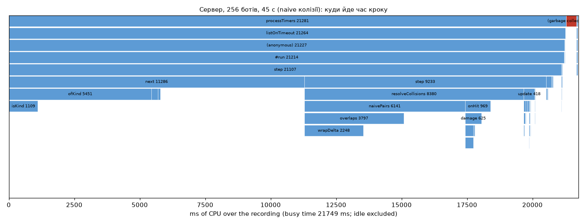

| Конфігурація (45 с, один матч) | Сутностей | крок p50 | p95 | **p99** | макс. |
|---|---|---|---|---|---|
| 64 боти, naive | 140 | 1.07 мс | 2.00 | 2.67 | 8.6 |
| 64 боти, просторовий хеш | 142 | 1.08 | 1.93 | 2.64 | 9.7 |
| 256 ботів, naive | 911 | 14.97 | 32.31 | **35.61** | 43.8 |
| 256 ботів, просторовий хеш | 882 | 15.82 | 29.16 | 32.18 | 51.8 |
| 256 ботів, naive + **кеш списків для ботів** | 871 | **6.16** | 15.92 | **18.71** | 27.9 |
| 256 ботів, хеш + кеш списків | 820 | 8.36 | 14.92 | 20.23 | 34.6 |

Профіль на 256 ботах показав, що головна гаряча точка — **не колізії**:
- **52 % кроку** займав ШІ ботів: кожен із 256 ботів проходив генератором `ofKind()` по всій `Map` світу;
- колізії (`naivePairs` + `overlaps` + `wrapDelta`) займали 28 %.

Що з цим зроблено:
- `World.ships()` / `World.balloons()` повертають масив, побудований один раз до наступної зміни світу.
  Це знизило p99 з 35.6 до **18.7 мс** і p50 з 15 до 6 мс.
- Просторовий хеш (`shared/src/sim/spatial.ts`, клітинка 100 од. на тор 16×9, пари відновлюються в
  порядку naive, тож симуляція не змінюється ні на біт — це перевіряють P7 і окремий unit-тест)
  **у щільному догфайті ботів не дав виграшу**: усі пілоти збираються в кількох клітинках, і хеш лише
  додає сортування та обхід. Зате в навантажувальному тесті, де гравці розкидані по арені, він
  виграє суттєво (нижче). Значення за замовчуванням — `COLLISION=hash`, вимкнути можна через `naive`.

### Боти

`shared/src/bot.ts`: `class Bot implements PlayerInput` повертає ті самі `Controls`, що й клавіатура:
1. ухиляється від аеростата попереду;
2. переслідує найближчий живий корабель;
3. стріляє, коли ціль у секторі ±0.15 рад і ближче за 520 од.

`Match` кладе вихід бота **в ту саму чергу input** з власним `seq`, через яку йдуть і пакети від сокетів. Тому сервер
обробляє ботів і людей одним кодом. Ендпоінт: `POST /api/rooms/:id/bots {"count": 8}`.

Тест знайшов баг: кімната, де лишилися самі боти, ніколи не вважалася порожньою і жила вічно. Профілювання
створювало кімнату на кожен прогін, і за кілька запусків список кімнат витіснив кнопку Join за межі
екрана. Тепер кімната «порожня», коли в ній немає жодного гравця з сокетом.

### Web Worker: експеримент і рішення — **no-go**

Перенесення частинок вибухів у Web Worker (`client/tools/worker-bench.html`, дані в `Float32Array`
передаються як transferable, тобто без копіювання). Вимірюється, скільки платить **головний потік** за кадр:

| Частинок | Головний потік сам | Головний потік з воркером (`postMessage` + прийом) | Затримка round-trip |
|---|---|---|---|
| 300 (реальний бій) | **0.0023 мс** | 0.0093 мс | 0.05 мс |
| 2 000 | 0.015 мс | 0.0087 мс | 0.06 мс |
| 20 000 | 0.134 мс | 0.011 мс | 0.15 мс |
| 200 000 | 1.07 мс | 0.013 мс | 1.15 мс |

Воркер виграє лише понад ~1500 частинок. У грі їх одночасно ≤ 300, і там воркер **вчетверо дорожчий**
для головного потоку, а частинки ще й відстають на кадр. Тому частинки лишаються в головному потоці, а
бенчмарк збережено як доказ.

### Навантажувальний тест

`server/scripts/load-test.ts` підключає до працюючого сервера N справжніх WebSocket-клієнтів без браузера.
Усі вони в **одній кімнаті**, з бінарним кодеком. Кожен 30 разів на секунду шле input за сценарієм: газ, повороти різної
довжини, черги пострілів. Після 5 с розігріву тест 12 с читає `/api/stats`:
- p50/p99 тривалості кроку за останні 300 кроків;
- зайнятість циклу подій (ELU) за це вікно;
- RSS;
- вихідні байти/с.

Сервер і клієнти працюють на одній машині: Ryzen 5 2600, loopback.

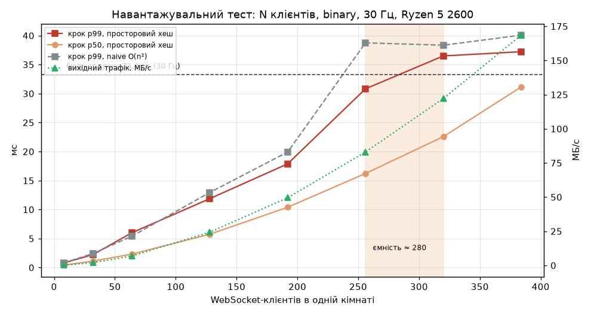

| Клієнтів | Сутностей | крок p50 | **крок p99** | ELU | RSS | вихід |
|---|---|---|---|---|---|---|
| 8 | 31 | 0.41 мс | 0.80 мс | 0.02 | 88 МБ | 0.17 МБ/с |
| 32 | 92 | 1.11 | 2.23 | 0.05 | 92 | 2.0 |
| 64 | 157 | 2.31 | 6.00 | 0.10 | 93 | 6.9 |
| 128 | 276 | 5.75 | 11.88 | 0.23 | 112 | 24.3 |
| 192 | 375 | 10.39 | 17.88 | 0.40 | 167 | 49.5 |
| 256 | 497 | 16.22 | **30.82** | 0.60 | 178 | 83.0 |
| 320 | 581 | 22.57 | **36.49** | 0.79 | 201 | 122.2 |
| 384 | 704 | 31.14 | 37.22 | **1.00** | 167 | 168.5 |

**Ємність одного процесу — ≈ 280 гравців в одній кімнаті.** p99 кроку перетинає бюджет 33.3 мс між 256 і
320 клієнтами, а при 384 цикл подій зайнятий на 100 %.

Що обмежує:
- **Трафік O(n²).** Кожен з n клієнтів щокроку отримує знімок усіх ~n сутностей, і для кожного він
  кодується окремо, бо `ack` у кожного свій. При 320 клієнтах це 122 МБ/с.
- **Колізії.** Тим самим прогоном з `COLLISION=naive` (`docs/lab07/load-naive.json`, сіра крива) межу перетинаємо
  раніше: p99 при 256 клієнтах — **38.75 мс** проти 30.82 з хешем. Тут гравці розкидані по арені, і просторовий хеш виграє,
  а в щільному догфайті ботів він трохи програвав. Хеш обмежує поганий випадок і майже нічого не коштує в
  доброму, тому він став значенням за замовчуванням.

Що зробив би далі:
- кодувати спільне тіло знімка один раз, а `ack` дописувати в заголовок;
- delta-знімки;
- область інтересу: не слати сутності, які гравець не бачить.

Для реальної гри з кімнатами по 4–8 гравців цей запас означає десятки кімнат на процес.


---

## Лабораторна 8. Публікуємо гру: Docker, метрики і жива адреса

### Процес, готовий до хостингу

**`SIGTERM` / `SIGINT`:**
1. `/ready` одразу віддає 503, тож проксі перестає слати нових гравців.
2. `server.close()` — сервер не приймає нових з'єднань.
3. Кожному клієнту йде `{type:"shutdown"}`, а сокет закривається з кодом **1001**.
4. Кімнати закриваються, і логи матчів дописуються, бо `pipeline` дочекався `close`.
5. Буфер pino скидається, процес завершується з кодом 0.
6. Запобіжник: якщо щось зависне, через 10 с процес виходить з кодом 1.

На Windows один процес не може надіслати сигнал іншому, тому тест на справжній `SIGTERM`
(`describe.skipIf(win32)` у `server.test.ts`) запускається в CI на Linux. Він піднімає `node src/index.ts`, підключає
гравця, шле `SIGTERM` і перевіряє:
- код виходу 0;
- код закриття сокета 1001;
- що повідомлення `shutdown` прийшло;
- що все це відбулося швидше за 10 с.

Те саме зробить `docker stop` — Docker надсилає саме `SIGTERM`.

**Чому `CMD ["node", "server/src/index.ts"]`, а не `npm start`.** У контейнері головна команда — це PID 1. `npm`
сигнал далі не передає, тож Node його не побачив би, і через 10 с Docker убив би процес `SIGKILL`: без `shutdown`,
без 1001, з обірваним логом.

| Ендпоінт | Відповідь |
|---|---|
| `GET /health` | liveness: `{status, version, tag, uptime, rooms, players, rss}`; `version` — git SHA збірки (`GIT_SHA` з CI → Docker `ARG`), і той самий SHA видно в HUD гри та в лобі (`build …`) |
| `GET /ready` | readiness: 200, поки процес **може пускати гравців**; 503 під час завершення і при `MAX_CONNECTIONS` |
| `GET /metrics` | Prometheus (`prom-client`): `skyduel_players`, `skyduel_rooms`, `skyduel_connections`, `skyduel_messages_in_per_second`, `skyduel_bytes_in/out_per_second`, `skyduel_tick_ms_p99`, `skyduel_event_loop_utilization`, `skyduel_process_resident_memory_bytes` (+ heap, GC, затримка циклу подій від `collectDefaultMetrics`), `skyduel_rejections_total{reason}` |

**Невідомі помилки:** `uncaughtException` / `unhandledRejection` → запис у лог зі стеком і `exit(1)`. «Глушити» їх
порожнім обробником не можна, процес перезапустить платформа.

**Логи — JSON-рядки через pino.** У кожному рядку гравця є `playerId`, а після входу ще й `roomId`. Рівень задає `LOG_LEVEL`,
а ключі `password`, `token`, `secret`, `authorization`, `cookie` замінюються на `[redacted]`:

```json
{"level":"warn","time":"2026-11-08T21:46:31.553Z","svc":"skyduel","playerId":672,"ip":"127.0.0.1","roomId":"night","code":4008,"reason":"rate limit exceeded","msg":"closing connection"}
```

**Конфіг через Zod** (`server/src/config.ts`, приклад — `server/.env.example`):
- `ALLOWED_ORIGINS` — якщо не задано, дозволено лише власний origin сервера і Vite dev;
- `MAX_CONNECTIONS`;
- `MAX_CONNECTIONS_PER_IP` (за замовчуванням 8);
- `MAX_ROOMS`;
- `MAX_PLAYERS_PER_ROOM`;
- ліміти повідомлень, `COLLISION`.

Будь-яке неправильне значення зупиняє старт з поясненням. Секретів у репозиторії немає: на платформі вони
лежать у сховищі секретів (`FLY_API_TOKEN` — у GitHub Secrets).

### Захист

- **Перевірка `Origin` на рукостисканні WebSocket.**
  - Сторінка з чужого сайту не може відкрити сокет від імені гравця (cross-site WebSocket hijacking).
  - Чужий `Origin` отримує **403**, і це рахується як `rejections_total{reason="bad_origin"}`.
  - Клієнти без браузера (`ws`, curl) `Origin` не надсилають і пропускаються: вони і так не мають кук гравця.
- **Не більше `MAX_CONNECTIONS_PER_IP` з'єднань з однієї IP** (**429**), загальна межа `MAX_CONNECTIONS` (**503**).
- **Ліміти з лаби 4 і далі в силі:**
  - `maxPayload` 4 КБ;
  - token bucket 60/с зі сплеском 120;
  - `join` протягом 5 с;
  - політика повільного клієнта;
  - heartbeat.

Тести (`server.test.ts → production endpoints and limits`):
- `/health` з версією, `/ready`, імена метрик;
- 403 на чужий Origin і лічильник `bad_origin`;
- 429 на третє з'єднання з однієї IP при ліміті 2;
- `/ready` → 503 одразу після початку завершення.

### Хаос-тести

`server/scripts/chaos.ts` (сервер запущено з `MAX_CONNECTIONS_PER_IP=64`, бо всі тестові клієнти йдуть з
127.0.0.1) і `tools/chaos-server-kill.mjs`:

| Сценарій | Що сталося | Цифри |
|---|---|---|
| **Клієнт зник посеред матчу** (`terminate()`, без close-фрейму — як закрита вкладка чи обірваний кабель) | у решти гравців оновився список пілотів, корабель прибрано | за **10–24 мс** (TCP повідомив про обрив); без жодного сигналу від мережі — heartbeat через ≤ 2×15 с |
| **Сміття ≈ 130 кадрів/с протягом 10 с** (бінарний і текстовий мотлох, з перепідключенням після кожного закриття) | кожне з'єднання закрито на **першому ж** кадрі: 4002 (`input before join`), 4000 (`invalid JSON`) | 636 з'єднань, 1276 кадрів, `skyduel_rejections_total{reason="bad_shape"}` і `{reason="bad_json"}` виросли на 643 кожен |
| **≈ 1300 валідних повідомлень/с** від гравця, що вже в кімнаті | token bucket вичерпано, з'єднання закрито **4008** | через **105 мс** (135 повідомлень = сплеск 120 + поповнення) |
| **Ізоляція:** у цей час у сусідній кімнаті літає 16 клієнтів | крок цієї кімнати **не виріс** | p99 2.27 мс до атаки → **1.23–1.70 мс** під час (`/api/stats`, ті самі значення в `skyduel_tick_ms_p99`) |
| **Сервер убито посеред матчу** (жорстко, без `shutdown`), потім запущено знову | клієнт отримав 1006 → гра зупинилась → **лобі з повідомленням** «З'єднання з сервером втрачено (код 1006). Спробуйте приєднатися ще раз.»; опитування лобі показує, що сервер недоступний, а коли сервер повертається — кімнати; Join → гра знову | у лобі за **42 мс**; кімнати видно через **2.5 с** після рестарту ([до](docs/lab08/chaos-1-playing.png) · [лобі](docs/lab08/chaos-2-lobby-after-kill.png) · [знову в грі](docs/lab08/chaos-3-playing-again.png)) |

При коректному завершенні (`docker stop`) клієнт отримує `shutdown` і бачить «Сервер перезапускається — повертаємось
у лобі…».

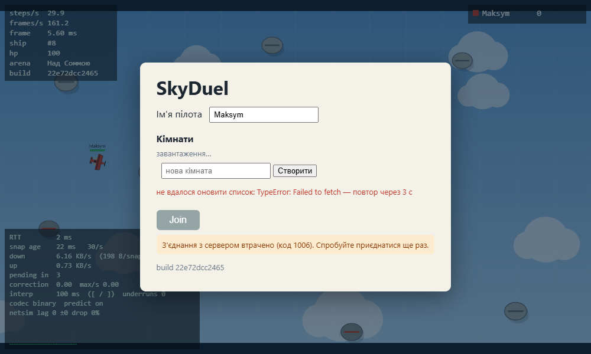

### Образ і пайплайн

**`Dockerfile`, два етапи:**
1. **Збирання.** `npm ci` (шар кешується, поки не змінилися `package*.json`), `vite build` клієнта з `GIT_SHA`,
   `npm prune --omit=dev`, видалення тестів і скриптів.
2. **Runtime.** `node:24-alpine` + лише production `node_modules`, `shared/`, `server/`, `client/dist`.
   Процес працює від користувача `node`, а не root. `HEALTHCHECK` опитує `/health`, `CMD` у exec-формі.

`.dockerignore` відкидає `node_modules`, `.git`, `docs`, тести, профілі. `compose.yaml` — production-подібний
локальний запуск.

**Розмір образу.** Docker на машині розробки не встановлено, тому образ збирає CI. Крок `Image size` у
`deploy.yml` пише точний розмір у підсумок запуску. Локально я відтворив фінальний етап (та сама
тека, `npm ci --omit=dev`): продакшен-залежностей **22 пакети, 14 МБ**, увесь застосунок **15 МБ**. Сервер з цієї теки
стартує, а `/health` віддає `version` і `tag` з `GIT_SHA`/`GIT_TAG`. Базовий `node:24-alpine` важить приблизно
150–160 МБ, тож **очікуваний розмір ≈ 170 МБ < 200 МБ**. Точну цифру з CI треба вписати сюди після першого релізу.

**GitHub Actions:**
- `ci.yml` на кожен push і PR: typecheck → lint → test → coverage → build → e2e;
- `deploy.yml` на тег `v*`:
  1. збирає образ з `GIT_SHA`/`GIT_TAG`;
  2. публікує в **GHCR** (`:v1.0.0` і `:latest`);
  3. пише розмір;
  4. якщо змінна `DEPLOY_TARGET=fly`, розгортає `flyctl deploy --image …`;
  5. **перевіряє, що `/health` живої адреси повертає SHA цього тегу**.

**Хостинг — Fly.io** (`fly.toml`):
- `force_https`: сторінка на https, тож `wsUrl()` будує **wss://**;
- `auto_stop_machines = "off"`: зупинена машина обірвала б усі матчі;
- `min_machines_running = 1` і рівно **одна** машина, бо всі гравці кімнати мусять бути в одному процесі;
- `kill_signal = SIGTERM`, `kill_timeout = 10s`;
- health check на `/health`.

**Heartbeat і проксі.** Ping сервера кожні 15 с тримає з'єднання живим крізь проксі Fly (простій обривається ~через
60 с), а клієнт пінгує ще й кожні 500 мс для netgraph.

### PWA

Встановлення підтримують:
- `manifest.webmanifest` (ім'я, `display: fullscreen`, ландшафт, кольори, іконки 192/512);
- `sw.js`:
  - статика — cache-first;
  - HTML — network-first, щоб новий деплой підхоплювався одразу;
  - `/api`, `/ws`, `/health`, `/metrics` не кешуються.

Сервіс-воркер реєструється лише в production-збірці. Перевірка Chrome
(`tools/pwa-check.mjs`, `Page.getInstallabilityErrors`) на production-збірці: **помилок установлення — 0**,
маніфест без помилок, сторінкою керує `sw.js` ([pwa.json](docs/lab08/pwa.json)). На телефоні: Chrome → «Встановити
застосунок» (потрібна https-адреса, тобто після деплою).

### Двоє гравців з різних мереж

**Ще не виміряно** — це потребує живої адреси і двох людей поза моєю мережею. До того з'явиться таблиця
нижче. Поки що — той самий бій двох вікон через інжектор мережі сервера з типовим для
міжміського маршруту профілем (`lag=60&jitter=20&drop=0.01`, `tools/net-lab5.mjs`, 15 с) — **це емуляція, не
інтернет**:

| Гравець | RTT | поправка p95 | вниз | недобір знімків |
|---|---|---|---|---|
| 1 (емуляція) | 74 мс | 0.0004 од. | 8.0 КБ/с | 0 |
| 2 (емуляція) | 61 мс | 0.0003 од. | 9.7 КБ/с | 0 |
| гравець з іншої мережі №1 | *заповнити з netgraph* | | | |
| гравець з іншої мережі №2 | *заповнити з netgraph* | | | |

Монітор доступності (UptimeRobot / Better Stack, перевірка `GET /health` раз на 5 хв) вмикається на живу адресу.

**Відео на 3–5 хвилин:** ~1 хв гри за публічним посиланням, netgraph, `/metrics`, хаос-тест з убитим сервером.
